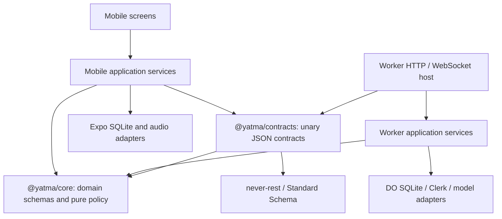

# Application interface register

Status: mixed implementation and target register for the
[private-alpha plan](../plans/private-alpha.md). Read each section's status
before treating an interface below as implemented or accepted. Health, sync
push, and unary turn HTTP contracts are mounted in the Worker. Mobile sync push
and unary turn controls use the typed HTTP client; live sync and turn observation
remain streams over WebSocket. Mounting and local tests do not establish
Cloudflare or native-device acceptance.

Outstanding acceptance includes Expo SQLite and Cloudflare Durable Object/SQLite
behavior, two-device sync/turn flows, and a configured EAS/App Store Connect
tester build with real auth, model, and audio bindings. The private-alpha plan
tracks these gates and their evidence separately from implementation checkmarks.

The [next-build plan](../plans/next-build.md) records F1–F4 and DS1–DS3 implementation
and acceptance evidence. Its N01 schemas and compatibility rules are implemented;
the rollout still requires deployed readers/gates before compatible clients.

## Dependency direction



Contracts contain schemas, operation names, and declared failure/status maps.
They do not contain handlers, auth implementations, hosts, storage, or provider
calls. Runtime handlers call application services. Domain policy never imports
contracts or runtime adapters.

## 1. Domain command planner — D1/D2

Proposed home: `packages/core/src/commands.ts`, with existing rules/undo/context
remaining focused pure modules.

| Operation      | Input                                                            | Output                                                      |
| -------------- | ---------------------------------------------------------------- | ----------------------------------------------------------- |
| `planBatch`    | Snapshot, validated commands, actor/reason/batch context         | Event drafts and explicit no-ops, or typed planning failure |
| `stampBatch`   | Drafts, observed maximum `at`, current clock, supplied event IDs | A validated ordered event batch                             |
| `planUndo`     | Full batch events, current state and latest-write provenance     | Reverts and explicit per-field skips                        |
| `buildContext` | Scope, active chat, snapshot, budget                             | Bounded context text plus inclusion/truncation metadata     |

The planner uses staged state across operations. No command writes storage.
Validation includes field caps, date/order-key formats, references, actor rules,
and required agent reasons. Every writer uses the same policy. A no-op produces
no event. The clock and ID sources are supplied rather than hidden global IO.

Undo groups by **entity and field**, retaining the earliest preimage and final
batch write. Value equality alone is insufficient when a later user edit returns
to the same value; latest-write provenance determines whether the batch still
owns that field. Created-then-updated entities retain creation undo semantics.

Implemented: core command planning and undo policy are in `commands.ts`,
`batch.ts`, `undo.ts`, and related pure modules. The coordinator should verify
that every planned writer uses the shared planner before marking this area
complete; native acceptance is separate.

## 2. Serialized mutation writer — D1/L1/S1

Implemented in part: both mobile and Worker have application mutation services
(`apps/mobile/src/application/mutations.ts` and
`apps/worker/src/application/mutations.ts`). The Worker wires its service into
UserSpace, agent tools, and curator; mutation-backed agent batches route writes
including undo through the service. The legacy EventStore fallback remains in
`agent/tools.ts` for contexts without an injected service. Worker mutation
operations check the durable account lifecycle fence before writes, and incoming
sync commits use the same guard. Mobile manual writes use the application
service. Expo SQLite/native acceptance is still outstanding.

```text
execute(commands, actor/batch context)
  → acquire mutation ownership
  → read current committed snapshot and observed clock
  → plan all commands against staged state
  → stamp and validate the complete batch
  → atomically commit journal and projections
  → publish committed state/events
  → release ownership
```

This is the boundary for manual edits, agent tools, curator, undo, and restore.
An interface accepting already-planned events does not solve stale snapshot
races. Snapshot acquisition through commit must share the serialization scope.

Internal application operations return `Effect.Effect<Success, TypedFailure>`.
The never-rest adapter provides the environment and converts typed failures to
declared `RailError` results. Domain planners may retain Effect's pure `Result`.
Avoid spreading neverthrow conversion through every internal function.

Provider calls run outside transactions and mutation locks. One `apply_changes`
call commits atomically; a model turn may make several such commits, all carrying
the same durable batch ID. A stopped turn keeps its already committed history.

## 3. Local journal — L1

Existing adapter: `apps/mobile/src/db/database.ts`.

| Port               | Required semantics                                                                              |
| ------------------ | ----------------------------------------------------------------------------------------------- |
| `readSnapshot`     | Read committed projections and clock/provenance needed by the writer                            |
| `commitLocalBatch` | Event batch and projections commit together; fail explicitly                                    |
| `mergeRemoteBatch` | Immutable event merge, authoritative sequence metadata, projections, and cursor commit together |
| `readOutbox`       | Events awaiting server sequence assignment, with bounded batches                                |
| `acknowledge`      | Idempotently add sequence assignments without rewriting historical content                      |
| `readBatch`        | Recover all events belonging to one durable batch                                               |
| `resetSession`     | Fence old asynchronous work, then clear local account state                                     |

All mutations serialize through one owner, including acknowledgement and remote
merge. Publish UI state only after successful commit. A failed transaction must
leave both persisted and published state unchanged. A session generation makes
old subscriptions/writes ineligible after sign-out or account switch.

Preserve `v: 1` event readers. Sequence metadata is authoritative server metadata;
it does not authorize replacing an event's type, timestamp, actor, or payload.
Preview-only memory storage is a separately selected adapter.

## 4. Server journal and sync command — S1/T1

Existing adapter: `apps/worker/src/eventStore.ts`. First shared contract:
`packages/contracts/src/sync.ts`.

| Operation             | Shape                                                       | Required semantics                                                      |
| --------------------- | ----------------------------------------------------------- | ----------------------------------------------------------------------- |
| `appendIncomingBatch` | Events plus verified principal/device context → assignments | Validate all events before writes; atomic journal/projection/FTS commit |
| `appendPlannedBatch`  | Writer-produced batch → committed events                    | Same commit invariants; trusted actor comes from application context    |
| `readAfter`           | Server cursor → bounded ordered batch and next cursor       | Monotonic per-user sequences                                            |
| `readBatch`           | Batch ID → all committed batch events                       | Shared by cards, read/history, and undo                                 |
| `observeCommits`      | Subscriber registration → committed batches                 | Publish after commit; no catch-up/live gap                              |

`pushEvents` uses current `SyncPushInput` / `SyncPushResult` through Standard
Schema. During S1/T1, the coordinator finalizes bounds and compatibility behavior.
Assignments must include duplicate event IDs with their original sequences.
An existing ID with different historical content yields `event_conflict`.

The server derives user identity from verified authentication. Incoming client
events do not create authority to impersonate an agent/server writer. Define
actor and device checks at this adapter boundary.

## 5. Sync lifecycle and streaming host — T1

Implemented: the contract `syncContract.pushEvents` is served at
`POST /api/sync/events`; Worker Clerk verification supplies the principal, and
the route bridges to `UserSpace`'s mutation-backed push. Mobile `sync.push`
uses this typed HTTP contract. Live subscription remains on WebSocket.
Expo/Cloudflare acceptance and two-device acceptance remain outstanding.

```text
SyncSession.start(authenticated session, committed cursor)
  → subscription handle/readiness
SyncSession.flushOutbox()
  → assignments committed locally
SyncSession.stop()
  → cancel observation/retries and fence callbacks
```

A live subscription has separate readiness and terminal completion. Boot must
not await its completion before flushing outbox. Incoming batch handlers are
awaitable: persist events/projections/cursor first, then acknowledge delivery.
Serialize batch handling and reject stale session generations.

Ordinary UI updates do not restart the session. Stable application-service
identity/lifetime replaces a dependency on render-created store functions.

Catch-up and live registration have one ordered handoff. Reconnect from the
committed cursor with fresh authentication; dedupe by immutable event ID.
An acknowledgement is not proof of persistence unless the repository committed.

never-rest owns unary JSON input/output/error contracts. The host owns WebSocket
upgrade, subscription identity, frame validation, acknowledgements, backpressure,
heartbeat, reconnect, and stream completion. Existing Effect RPC streams stay
until a tested host adapter replaces them; avoid a new socket protocol during
the initial library adoption.

## 6. Turn service and supervisor — R1/U1

Implemented in part: unary contract operations `startTurn`, `getTurn`, and
`stopTurn` are mounted below `/api/turns`, and the host bridges them to
UserSpace. Mobile invokes these operations through the typed HTTP client. The
Worker supervisor persists turn state and recovery records, while observation
remains a WebSocket stream. The target behaviors below remain the acceptance
contract; deployed socket-disconnect and Durable Object restart acceptance have
not been established.

| Unary operation | Target input/output                                                                   |
| --------------- | ------------------------------------------------------------------------------------- |
| `startTurn`     | Request/message IDs, chat/scope, text, unsent events → chat/turn/batch IDs and status |
| `getTurn`       | Turn ID → status, terminal result, recoverable batch/message references               |
| `stopTurn`      | Turn ID → cancellation receipt/status                                                 |
| `wrapUpChat`    | Request ID and chat ID → supervised curation receipt                                  |

Target receipt vocabulary: `turnId`, `chatId`, `batchId`, and status
`queued | running | completed | stopped | failed | interrupted`. The coordinator
owns the final core DTOs before runtime and UI agents implement them.

Start is idempotent by client request identity. Identical message text may occur
in many legitimate turns. Observation uses a separate `observeTurn(turnId,
after)` host stream and never owns the supervisor. Return IDs before provider
completion so Stop works on a new chat.

Persist state and terminal results. Establish app/socket-disconnect survival in
the actual Cloudflare runtime. DO restart recovery is a separate guarantee:
recover state and either safely resume from checkpoints or report interruption.
Do not imply automatic exactly-once replay of external model calls.

The change-card projection aggregates all committed events sharing the turn's
batch ID. It survives reload and reports partial/skipped undo. Early Changes
frames merge through the same durable repository as sync frames.

Chat task presentation follows the [product reference](../product.md#tasks-inside-chat)
and the [task-widget plan](../plans/thread-task-widgets.md), updated 2026-11-10.
Target: the permanent conversation (`PERSONAL_THREAD_ID`) embeds live task blocks
by ID, with shared committed state, stable per-message list membership/order,
task-detail overlays, and a bounded presentation window. Repeated occurrences
share entity identity but have distinct rendering keys. Reopening is an ordinary
status edit; whole-turn Undo remains batch/provenance based. No new transport
contract is needed for local widgets.

Local facade semantics are defined in the
[widget plan](../plans/thread-task-widgets.md#key-facades-and-contracts): F1
`TaskInteractions` wraps committed reads/status writes and shared pending state;
F2 `ThreadTimeline` wraps windowed messages/reference presentation; F3
`TaskNavigation` wraps task overlays and project navigation; F4 `ThreadCapture`
wraps atomic manual task/receipt batches. All four are implemented as local modules
over the existing store/writer, as recorded in section 10 below.
The [Gurki acceptance specs](../specs/thread-task-widgets.spec.md) carry stable
scenario-family IDs mapped to implementation tasks and verification in that plan.
They distinguish immediate behavior, outputs, outcomes, and possible next
scenarios. Gurki validation is separate from application-test acceptance.

Still implemented: the home tab opens at a collapsing global priority list;
`selectThreadHistory` interleaves existing chat messages with completion
transitions from the committed journal, retaining event-time titles and dates
after later edits/reopening. The home renderer currently forces task links.
Storage still hydrates/refolds full history; UI windowing alone will not bound
that cost. Widget/window/overlay implementation and runtime acceptance are pending.

`Task.tags` and `Chat.headings` remain
optional v1 compatibility fields. `planProjectConsolidation` converts them through
the serialized atomic writer, preserving explicit project assignments and leaving
multi-tag tasks unassigned. Stable normalized-name IDs avoid duplicate migrated
projects across offline clients. Original tag/heading values stay in event preimages.
Live tasks group by `projectId`, with priority retained within and across groups.
Optional project description, target date, and bookmarks flow through shared
schemas, staged planning, folding, and provenance-aware Undo. New date commands
reject impossible calendar dates without narrowing the legacy event reader.
Circle actions submit normal completion commands; Undo reopens; title actions
navigate to the task. Dropdown/slash capture and messages use the same atomic
writer. Historical commentary, completion history, live tasks, and durable
batch/change summaries are separate projections of committed state.

## 7. Model gateway and usage ledger — R2

POC addition (2026-11-16): `ModelSettings` / `SaveModelSettings` are shared Effect
schemas used by `@yatma/contracts/modelSettings` and the internal DO RPC bridge.
GET/PUT/DELETE `/api/settings/model` targets only the Worker-verified principal.
The private `model_settings` table contains the model ID and account-bound AES-GCM
ciphertext, never event records. The server encryption secret is deployment-owned;
no key is returned to clients. `resolveModel()` supplies the current credential to
each supervised turn and curator execution. Raw credentials are not turn inputs.
API-key and OAuth authentication for other model providers remain outside this POC.

Implemented in part: Worker has a model gateway, usage ledger, and supervisor
modules (`agent/modelGateway.ts`, `agent/usage.ts`, `agent/supervisor.ts`).
`agent/turn.ts` remains in the runtime and some accounting/admission behavior
must be reviewed against the target semantics below. Model/provider credentials
and Cloudflare runtime acceptance remain outstanding.

| Port                  | Required semantics                                                                 |
| --------------------- | ---------------------------------------------------------------------------------- |
| `ModelGateway.stream` | Context and shared toolkit → text/tool/usage progress                              |
| `UsageLedger.reserve` | User/operation/request ID and bounded allowance → reservation or `budget_exceeded` |
| `UsageLedger.settle`  | Reservation and actual spent usage → durable usage snapshot                        |
| `UsageLedger.get`     | Actual used, reserved, limit, and UTC daily reset time                             |

Use the same core toolkit schemas in real and scripted provider adapters. Tool
handlers consume the writer/journal interfaces. A failed tool returns declared
error data with useful recovery advice; it does not partially commit.

Reserve before calls and settle every exit path. Preserve spent usage even when
it exceeds the cap; release unspent reservations. Include curator work. Admission
and settlement serialize so concurrent turns cannot both spend the same allowance.

## 8. Context and knowledge — K1

`ContextService.inspect(scope, activeChatId, budget)` returns the same snapshot,
text, token estimate, and truncation metadata supplied to the model. The preview
must not rebuild a different input without the active chat.

`KnowledgeService.editBrief`, `pinPage`, `restorePage`, and `wrapUp` consume the
writer. Wrap-up consumes existing briefs/pages, task state, conversation, model
gateway, and usage ledger. Its durable batch/card includes all knowledge writes.
Idle callbacks verify they were not superseded before reserving usage.

Budget is a hard bound with a documented fallback when briefs, pinned bodies,
summaries, or messages are large. Token estimation policy and reserved model
output/tool space are explicit. Preserve the highest-priority context while
reporting what was truncated.

## 9. Identity and account lifecycle — I1

Target: `SessionLifecycle` owns sign-in/offline selection, account generation,
sync shutdown, and local cleanup. `AccountService.delete(requestId)` owns the
full deletion workflow. `UserSpace` now migrates and uses the Worker
`accountDeletion` SQLite record for pending/completed state and retry metadata,
preserving it when event data is cleared. A retry repeats the remote Clerk
delete while the record is pending; completed deletion is idempotent. The
mutation service and user-space handlers check the lifecycle fence so stale
mutations, turns, subscriptions, and callbacks are rejected. The mobile API
still exposes a simple `account.delete` request rather than a status/polling receipt, and
Cloudflare deletion/recreation behavior remains to be accepted in the real
runtime.

Return a receipt with operation identity and explicit pending/completed state,
or a typed failure with recovery advice. Pending is not complete. The contract
owner finalizes polling/retry semantics before implementation. Retain enough
deletion progress to retry external failure; do not wipe the retry record first.

## 10. Daily stack and player — implemented locally

The [daily-stack plan](../plans/daily-stack-player.md) defines DS1 `DailyStack`
(daily entries, order, allocation, atomic next-day transfer), DS2 `StackPlayer`
(device-owned time intervals, playback, completion, clock/reminder ports), and
DS3 `StackTemplates` (opening sequence, queue composition, automatic break reconciliation).
The [Gurki model](../specs/daily-stack-player.spec.md) contains target scenarios;
the [next-build execution ledger](../plans/next-build.md#execution-ledger--2026-11-10)
separately records local tests, browser evidence and unverified external gates.

| Boundary              | Implemented entry point                                                                          | Consumers / invariants                                                                                                                                                                                    |
| --------------------- | ------------------------------------------------------------------------------------------------ | --------------------------------------------------------------------------------------------------------------------------------------------------------------------------------------------------------- |
| DS1                   | Mobile `application/dailyStack.ts`, shared `planBatch` + `dailyPolicy.ts`                        | Today/TaskSheet use existing local serialized writer; Worker writer uses the same planner. One semantic day per account/date retains its initial timezone; task/day identity deduplicates linked entries. |
| DS2                   | Mobile `application/stackPlayer.ts`, `features/player/PlayerProvider.tsx`; core `stackPlayer.ts` | One runtime above routes; explicit actions commit before display. Supplied clocks and device ownership; timestamps survive reload; expiry never completes or advances.                                    |
| DS3                   | Core `stackTemplates.ts`, daily commands through DS1                                             | Versioned snapshots instantiate independent entries. Future-only break reconciliation preserves manual edits, suppression and dismissed actual-work thresholds.                                           |
| Clock/reminders/media | `application/reminders.ts`, `recordingLifecycle.ts`, `audioSession.ts`, player media components  | Account-generation fences and globally serialized reminder ownership; microphone ownership pauses ambience until native stop completes. Media preference changes emit no work events.                     |

Exact additive schemas and command shapes are core `stackSchemas.ts` and
`dailyCommands.ts`, exported by `@yatma/core`. Folded state has days, dayEntries,
workIntervals, stackTemplates and stackPreferences in addition to existing maps.
Both mobile and Worker journal/projection readers support them in atomic batches.
Day ordering never changes task position/due date. Linked completion/deletion uses
the shared planner and stops known intervals in the same commit. Historical task
terminals also clamp unseen offline runs; impossible start-after-terminal records
close at zero with a review reason. Overlaps remain inspectable and are not summed
twice. Undo restores eligible daily fields, routine versions and corrections, while
preserving later writes and never reopening historical intervals.

Reader capability `eventSchemaVersion: 2` is independent of event envelope `v: 1`.
Sync push/subscribe and all event-bearing turn/chat read/start/observe/wrap-up
paths reject absent/older capabilities before writes or delivery. HTTP uses shared
never-rest contracts with `upgrade_required: 426`; GET turn results receive the
capability as a query string. Stream decoders validate complete event-bearing
frames before callbacks/Ack. Unsupported reads fail closed without advancing
cursors; client upgrade state preserves the outbox and stops futile retries.
Server readers/gates must be deployed before compatible client writers roll out.

F1–F4 are also implemented: account-scoped task interaction coordination is composed
in `state/atoms.ts`; core thread selectors plus `features/chat/messageParts.ts` and
`useThreadTimeline.ts` provide flattened 50/50/150 presentation; task navigation
uses a transparent overlay; `application/threadCapture.ts` commits offline capture
and capped Show tasks receipts through the existing writer. This bounds presentation,
not full-journal storage hydration. Native/Cloudflare/connected-device acceptance
remains outstanding as recorded in the execution ledger.

Daily order/date are separate from `Task.position` and task due date. Linked
task completion shares the mutation boundary with chat widgets; known local
interval stop and daily entry resolution must commit with it. A run unseen on
another offline device requires owner-side reconciliation, with effective stop
time/clock-skew policy implemented in next-build N01; local atomicity cannot stop
an unseen offline run. F1 and DS2 share the core batch planner rather than calling
each other. Extend/requeue/defer does not
complete a task. Templates prepend an opening while preserving the work queue;
daily inbox assembly materializes the queue and configured automatic breaks once
per day. Manual task/break edits take precedence over future reconciliation;
suppression prevents removed breaks from immediately returning. Expanded-player
scene selection is independent presentation/media state, not a timer command.

The implemented core schemas/events/folds and explicit mobile/Worker cache/sync
support retain v1 task readers. Preserve those readers and
never advance cursors past unsupported events. Keep core Effect-only, shared
never-rest contracts for any changed unary boundary, and existing host-owned
streams. Offline playback cannot promise one globally exclusive runner; retain
and surface cross-device interval overlap.

## 11. Conversation planning — local implementation, 2026-11-11

Conversation is the query/planning layer; Today/focus is the work surface.
Shared Effect model-tool schemas remain in core `tools.ts` and are consumed by
both real and scripted gateways. `read_day` reads the requested semantic day,
entries/history, intervals and preferences without writing. `plan_day` translates
explicit requested selections/allocations/order/removals through the existing
Worker mutation service, with one audited reason and atomic failure. It does not
assemble the backlog, start work or complete tasks. Entry/move targets must belong
to that day. Project reads and stable `project:p_…` references share identity with
manual project/task navigation. `list_tasks` returns total/nextOffset for complete
inspection, honors explicit status, and excludes deleted tasks.

Optional `TurnStartInput.planning` is the shared validated `{date, timezone}` DTO.
The mobile adapter supplies its local calendar; the existing never-rest turn
contract validates it; the supervisor persists/forwards it and includes it in
retry identity only when supplied (legacy signatures remain valid). Model context
uses this calendar and a bounded selected-stack summary; legacy calls use observed
day context or ask for an unknown timezone. No separate planning HTTP endpoint was
introduced. Suggestions alone do not invoke `plan_day`.

Mobile `/list` uses the serialized local writer and live task refs, without a
model connection or silent 50-task truncation. Mention insertion rechecks committed
entity identity and escapes labels. Focus keeps the same account-owned runtime,
with no separate global dock. New daily assembly opts out of backlog import;
manual/routine/carried selections remain explicit, and historical fields/readers
remain compatible. Legacy matrix URLs redirect to Today without deleting data.
Local automated/browser evidence is recorded in the next-build refinements ledger;
provider, deployed and native acceptance remain separate.

## Error vocabulary at the boundary

| Code                                                | Intended behavior                                              |
| --------------------------------------------------- | -------------------------------------------------------------- |
| `validation_error`                                  | never-rest input validation; handler is not invoked            |
| `invalid_event`                                     | Domain/envelope rejection; nothing committed                   |
| `clock_skew`                                        | Explain how to correct the device clock; no blind retry        |
| `event_conflict`                                    | Existing event ID has different content; investigate/reconcile |
| `not_found`                                         | Recover by refreshing/selecting an existing entity             |
| `unauthorized`                                      | Refresh authentication or sign in                              |
| `budget_exceeded`                                   | Show real usage/reset; wait or reduce work                     |
| `deletion_failed`                                   | Preserve deletion progress and offer safe retry                |
| `unavailable` / declared transient dependency error | Retry only when the operation is idempotent                    |
| `internal`                                          | Boundary contains defects without exposing diagnostic details  |

Each contract declares its own domain codes/statuses. never-rest host/client
errors are additional boundary failures, not copies of domain errors. Messages
must already be safe: public disclosure strips diagnostic context/cause, but it
does not sanitize an arbitrary message. `nextStep` is actionable advice; `origin`
and cause/context serve trusted diagnostics. Never elevate disclosure from a
caller-supplied header.

## Conversation review and inbound work — 2026-11-11

Local implementation extends the permanent conversation with durable review items,
separate from task status and daily membership. Core `review.ts` / `reviewPolicy.ts`
are the shared schema and policy; `review.received` and `review.updated` use the
existing v1 event envelope and **reader capability 3**. Deploy compatible server
readers/gates before new clients/producers. Existing records remain readable.

`review.receive` deduplicates source identity/revision; `review.decide`, `review.seen`
and `review.link` use the existing serialized writers. Both SQLite adapters project
review items, and JSONL export includes their ordinary journal events. Field-aware
Undo restores review choices without erasing provider receipts. Offline manual
review uses the sync contract; no duplicate review-mutation HTTP API is introduced.
Worker `read_review` pages evidence (10 default, maximum20; source snippets800 chars)
and `decide_review` records explicit decisions and atomic Today selection, including
creating/linking an external suggestion only on selection.

`@yatma/contracts/review` declares mounted GET/POST `/api/review/schedule`;
`@yatma/contracts/gmail` declares mounted status/begin/complete/import/disconnect
operations. Mobile typed clients, HTTP hosts and internal UserSpace RPC share schema
DTOs from `connectionSchemas.ts`. Host authentication selects the account; provider
receipt events are rejected at client event ingress. The Gmail adapter uses read-only
OAuth, bounded INBOX imports, server-only credentials and source identity by email
plus message ID. Optional schedule callbacks share Alchemy's scheduler with curation.
Account lifecycle checks and operation locks fence publication/import/deletion.

See the [execution ledger](../plans/conversation-prioritisation.md#execution-ledger)
and [Gmail configuration](../development/gmail.md). Automated/scripted tests and
web observations do not establish real-provider, native or deployed acceptance.

## Future project sharing boundary

Target only; sharing, invitations and membership authorization are not implemented.
`Task.projectId` remains nullable: a task belongs to zero or one project. The global
Tasks catalog is a personal view over accessible tasks, not itself a shareable
container. Projects provide the intended future collaboration boundary.

Before enabling sharing, define project ownership, membership roles, invitations
and revocation, then enforce access on server reads, commands and subscriptions.
The current account-isolated `UserSpace` journal is not a shared-project authority;
project-scoped storage/sync routing and migration need an explicit design. Client
filtering or adding a share button is not an authorization boundary.

Personal Today plans, preferences, conversations, unassigned tasks and time logs
must not become shared simply because a project is shared. Decide which task
fields/history become visible when moving a private task into a shared project,
what happens on removal/revocation, and how personal time summaries are exposed
before implementing that transition. No sharing schema or access flags are added
by the standalone Tasks/Routines navigation work.

## Task todos — 2026-11-11

`Task.todos` is an optional ordered array of `{ text, done }` values, defaulting to
empty for legacy events/cache rows. These are plain checklist strings with a
completion bit, not task entities: no project, scheduling or task lifecycle.
Create/update schemas and task events carry the same bounded schema (200 items,
500 characters per nonempty string). The existing task mutation writer commits
and projects the list atomically. Undo records/restores the whole field while
respecting later edits; concurrent list edits use existing last-write semantics.

Reader capability is now **4**, still with event envelope v1. Deploy matching
server readers/gates before enabling these clients; old schema decoders can strip
unknown checklist fields. Existing descriptions keep their `notes` storage/API
field; only the user-facing task label changes to Description.

## Priority and scheduled dates — 2026-11-11

Task create/update/event schemas add nullable `priority` (high/medium/low) and
`scheduledDate` (calendar date). Missing legacy values fold to null; `dueDate`
remains a separate actual deadline. Shared planning/folding, local and Worker
journal projections and field-aware Undo preserve the distinction. Schedule
presets use explicit local-day input and Monday-based calendar weeks. No schema
migration converts existing due dates into schedules. Retired place/mentalMode
fields are preserved in historical readers but omitted from UI/planning context.

Sync reader capability is now **5** (event envelope remains v1). Deploy matching
Worker readers before new clients to prevent older decoders stripping new fields.
The planning context includes importance, schedule and deadline separately.

## Schedule-derived Today membership — 2026-11-11

`Task.scheduledDate` is the authority for daily task membership. The shared batch
planner reconciles affected existing days after schedule changes; `day.ensure`
materializes tasks already scheduled for that day. Legacy daily add/remove/Tomorrow
commands update the linked task schedule, so UI and agent entry points share the
same rule. Pending execution entries are removed/revived without deleting work
intervals or resetting allocation/order. Completed tasks do not become playable
merely by retaining today's scheduled date. Activities remain independent entries.

The mobile daily facade has one `scheduleTask` operation; the duplicate addTask
operation and caller-side entry-removal planning have been removed. Schedule
shortcuts use this same operation. No schema or transport capability change.
