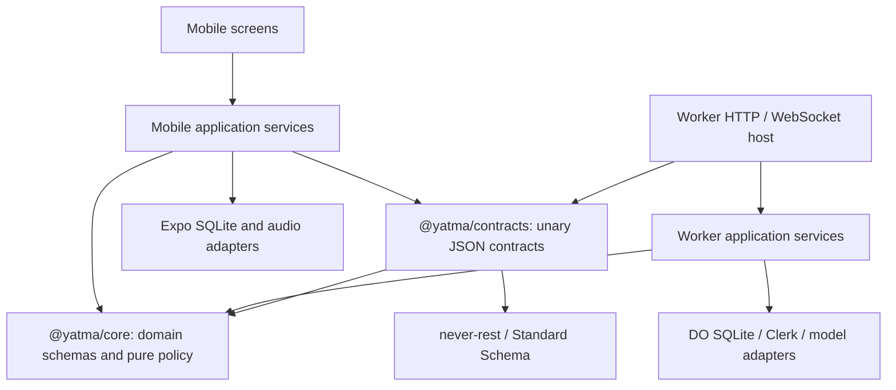

# Application interface register

Status: target interfaces for the [private-alpha plan](../plans/private-alpha.md).
The implemented never-rest surface currently consists of the health mount and
an unmounted sync contract. Other names below are design commitments for the
listed work items, not claims that these services already exist.

## Dependency direction



Contracts contain schemas, operation names, and declared failure/status maps.
They do not contain handlers, auth implementations, hosts, storage, or provider
calls. Runtime handlers call application services. Domain policy never imports
contracts or runtime adapters.

## 1. Domain command planner — D1/D2

Proposed home: `packages/core/src/commands.ts`, with existing rules/undo/context
remaining focused pure modules.

| Operation      | Input                                                            | Output                                                      |
| -------------- | ---------------------------------------------------------------- | ----------------------------------------------------------- |
| `planBatch`    | Snapshot, validated commands, actor/reason/batch context         | Event drafts and explicit no-ops, or typed planning failure |
| `stampBatch`   | Drafts, observed maximum `at`, current clock, supplied event IDs | A validated ordered event batch                             |
| `planUndo`     | Full batch events, current state and latest-write provenance     | Reverts and explicit per-field skips                        |
| `buildContext` | Scope, active chat, snapshot, budget                             | Bounded context text plus inclusion/truncation metadata     |

The planner uses staged state across operations. No command writes storage.
Validation includes field caps, date/order-key formats, references, actor rules,
and required agent reasons. Every writer uses the same policy. A no-op produces
no event. The clock and ID sources are supplied rather than hidden global IO.

Undo groups by **entity and field**, retaining the earliest preimage and final
batch write. Value equality alone is insufficient when a later user edit returns
to the same value; latest-write provenance determines whether the batch still
owns that field. Created-then-updated entities retain creation undo semantics.

Existing implementation: `rules.ts`, `undo.ts`, `clock.ts`, `events.ts`; command
orchestration is duplicated in mobile `events/write.ts` and Worker `agent/tools.ts`.

## 2. Serialized mutation writer — D1/L1/S1

Proposed homes: mobile `src/application/mutations.ts` and Worker
`src/application/mutations.ts`; injected storage ports live beside their adapters.

```text
execute(commands, actor/batch context)
  → acquire mutation ownership
  → read current committed snapshot and observed clock
  → plan all commands against staged state
  → stamp and validate the complete batch
  → atomically commit journal and projections
  → publish committed state/events
  → release ownership
```

This is the boundary for manual edits, agent tools, curator, undo, and restore.
An interface accepting already-planned events does not solve stale snapshot
races. Snapshot acquisition through commit must share the serialization scope.

Internal application operations return `Effect.Effect<Success, TypedFailure>`.
The never-rest adapter provides the environment and converts typed failures to
declared `RailError` results. Domain planners may retain Effect's pure `Result`.
Avoid spreading neverthrow conversion through every internal function.

Provider calls run outside transactions and mutation locks. One `apply_changes`
call commits atomically; a model turn may make several such commits, all carrying
the same durable batch ID. A stopped turn keeps its already committed history.

## 3. Local journal — L1

Existing adapter: `apps/mobile/src/db/database.ts`.

| Port               | Required semantics                                                                              |
| ------------------ | ----------------------------------------------------------------------------------------------- |
| `readSnapshot`     | Read committed projections and clock/provenance needed by the writer                            |
| `commitLocalBatch` | Event batch and projections commit together; fail explicitly                                    |
| `mergeRemoteBatch` | Immutable event merge, authoritative sequence metadata, projections, and cursor commit together |
| `readOutbox`       | Events awaiting server sequence assignment, with bounded batches                                |
| `acknowledge`      | Idempotently add sequence assignments without rewriting historical content                      |
| `readBatch`        | Recover all events belonging to one durable batch                                               |
| `resetSession`     | Fence old asynchronous work, then clear local account state                                     |

All mutations serialize through one owner, including acknowledgement and remote
merge. Publish UI state only after successful commit. A failed transaction must
leave both persisted and published state unchanged. A session generation makes
old subscriptions/writes ineligible after sign-out or account switch.

Preserve `v: 1` event readers. Sequence metadata is authoritative server metadata;
it does not authorize replacing an event's type, timestamp, actor, or payload.
Preview-only memory storage is a separately selected adapter.

## 4. Server journal and sync command — S1/T1

Existing adapter: `apps/worker/src/eventStore.ts`. First shared contract:
`packages/contracts/src/sync.ts`.

| Operation             | Shape                                                       | Required semantics                                                      |
| --------------------- | ----------------------------------------------------------- | ----------------------------------------------------------------------- |
| `appendIncomingBatch` | Events plus verified principal/device context → assignments | Validate all events before writes; atomic journal/projection/FTS commit |
| `appendPlannedBatch`  | Writer-produced batch → committed events                    | Same commit invariants; trusted actor comes from application context    |
| `readAfter`           | Server cursor → bounded ordered batch and next cursor       | Monotonic per-user sequences                                            |
| `readBatch`           | Batch ID → all committed batch events                       | Shared by cards, read/history, and undo                                 |
| `observeCommits`      | Subscriber registration → committed batches                 | Publish after commit; no catch-up/live gap                              |

`pushEvents` uses current `SyncPushInput` / `SyncPushResult` through Standard
Schema. During S1/T1, the coordinator finalizes bounds and compatibility behavior.
Assignments must include duplicate event IDs with their original sequences.
An existing ID with different historical content yields `event_conflict`.

The server derives user identity from verified authentication. Incoming client
events do not create authority to impersonate an agent/server writer. Define
actor and device checks at this adapter boundary.

## 5. Sync lifecycle and streaming host — T1

Existing code: mobile `sync/client.ts`, `sync/engine.ts`, auth bridge; Worker
`UserSpace.ts`. Target unary operation: `syncContract.pushEvents`.

```text
SyncSession.start(authenticated session, committed cursor)
  → subscription handle/readiness
SyncSession.flushOutbox()
  → assignments committed locally
SyncSession.stop()
  → cancel observation/retries and fence callbacks
```

A live subscription has separate readiness and terminal completion. Boot must
not await its completion before flushing outbox. Incoming batch handlers are
awaitable: persist events/projections/cursor first, then acknowledge delivery.
Serialize batch handling and reject stale session generations.

Ordinary UI updates do not restart the session. Stable application-service
identity/lifetime replaces a dependency on render-created store functions.

Catch-up and live registration have one ordered handoff. Reconnect from the
committed cursor with fresh authentication; dedupe by immutable event ID.
An acknowledgement is not proof of persistence unless the repository committed.

never-rest owns unary JSON input/output/error contracts. The host owns WebSocket
upgrade, subscription identity, frame validation, acknowledgements, backpressure,
heartbeat, reconnect, and stream completion. Existing Effect RPC streams stay
until a tested host adapter replaces them; avoid a new socket protocol during
the initial library adoption.

## 6. Turn service and supervisor — R1/U1

Proposed Worker home: `src/application/turns.ts` with provider/stream adapters
under `src/agent/`. The host composes these services; it does not run the model.

| Unary operation | Target input/output                                                                   |
| --------------- | ------------------------------------------------------------------------------------- |
| `startTurn`     | Request/message IDs, chat/scope, text, unsent events → chat/turn/batch IDs and status |
| `getTurn`       | Turn ID → status, terminal result, recoverable batch/message references               |
| `stopTurn`      | Turn ID → cancellation receipt/status                                                 |
| `wrapUpChat`    | Request ID and chat ID → supervised curation receipt                                  |

Target receipt vocabulary: `turnId`, `chatId`, `batchId`, and status
`queued | running | completed | stopped | failed | interrupted`. The coordinator
owns the final core DTOs before runtime and UI agents implement them.

Start is idempotent by client request identity. Identical message text may occur
in many legitimate turns. Observation uses a separate `observeTurn(turnId,
after)` host stream and never owns the supervisor. Return IDs before provider
completion so Stop works on a new chat.

Persist state and terminal results. Establish app/socket-disconnect survival in
the actual Cloudflare runtime. DO restart recovery is a separate guarantee:
recover state and either safely resume from checkpoints or report interruption.
Do not imply automatic exactly-once replay of external model calls.

The change-card projection aggregates all committed events sharing the turn's
batch ID. It survives reload and reports partial/skipped undo. Early Changes
frames merge through the same durable repository as sync frames.

Chat task presentation follows the [product reference](../product.md#tasks-inside-chat).
Message content selects stable task references and optional commentary; the UI
resolves current titles, statuses, and completion dates from committed local
state. Status-based grouping is a live projection of those referenced tasks.
Circle actions submit normal complete/reopen commands; title actions navigate to
the task. Historical commentary is not written back into task fields. The list
projection and the durable batch/change-summary projection remain separate.

## 7. Model gateway and usage ledger — R2

Existing code: core `tools.ts`, Worker `agent/openrouter.ts`, `agent/usage.ts`,
duplicated accounting in `agent/turn.ts`.

| Port                  | Required semantics                                                                 |
| --------------------- | ---------------------------------------------------------------------------------- |
| `ModelGateway.stream` | Context and shared toolkit → text/tool/usage progress                              |
| `UsageLedger.reserve` | User/operation/request ID and bounded allowance → reservation or `budget_exceeded` |
| `UsageLedger.settle`  | Reservation and actual spent usage → durable usage snapshot                        |
| `UsageLedger.get`     | Actual used, reserved, limit, and UTC daily reset time                             |

Use the same core toolkit schemas in real and scripted provider adapters. Tool
handlers consume the writer/journal interfaces. A failed tool returns declared
error data with useful recovery advice; it does not partially commit.

Reserve before calls and settle every exit path. Preserve spent usage even when
it exceeds the cap; release unspent reservations. Include curator work. Admission
and settlement serialize so concurrent turns cannot both spend the same allowance.

## 8. Context and knowledge — K1

`ContextService.inspect(scope, activeChatId, budget)` returns the same snapshot,
text, token estimate, and truncation metadata supplied to the model. The preview
must not rebuild a different input without the active chat.

`KnowledgeService.editBrief`, `pinPage`, `restorePage`, and `wrapUp` consume the
writer. Wrap-up consumes existing briefs/pages, task state, conversation, model
gateway, and usage ledger. Its durable batch/card includes all knowledge writes.
Idle callbacks verify they were not superseded before reserving usage.

Budget is a hard bound with a documented fallback when briefs, pinned bodies,
summaries, or messages are large. Token estimation policy and reserved model
output/tool space are explicit. Preserve the highest-priority context while
reporting what was truncated.

## 9. Identity and account lifecycle — I1

`SessionLifecycle` owns sign-in/offline selection, account generation, sync
shutdown, and local cleanup. `AccountService.delete(requestId)` owns durable
deletion progress, turn/curator cancellation, write fencing, DO cleanup, and
external Clerk deletion.

Return a receipt with operation identity and explicit pending/completed state,
or a typed failure with recovery advice. Pending is not complete. The contract
owner finalizes polling/retry semantics before implementation. Retain enough
deletion progress to retry external failure; do not wipe the retry record first.

## Error vocabulary at the boundary

| Code                                                | Intended behavior                                              |
| --------------------------------------------------- | -------------------------------------------------------------- |
| `validation_error`                                  | never-rest input validation; handler is not invoked            |
| `invalid_event`                                     | Domain/envelope rejection; nothing committed                   |
| `clock_skew`                                        | Explain how to correct the device clock; no blind retry        |
| `event_conflict`                                    | Existing event ID has different content; investigate/reconcile |
| `not_found`                                         | Recover by refreshing/selecting an existing entity             |
| `unauthorized`                                      | Refresh authentication or sign in                              |
| `budget_exceeded`                                   | Show real usage/reset; wait or reduce work                     |
| `deletion_failed`                                   | Preserve deletion progress and offer safe retry                |
| `unavailable` / declared transient dependency error | Retry only when the operation is idempotent                    |
| `internal`                                          | Boundary contains defects without exposing diagnostic details  |

Each contract declares its own domain codes/statuses. never-rest host/client
errors are additional boundary failures, not copies of domain errors. Messages
must already be safe: public disclosure strips diagnostic context/cause, but it
does not sanitize an arbitrary message. `nextStep` is actionable advice; `origin`
and cause/context serve trusted diagnostics. Never elevate disclosure from a
caller-supplied header.
