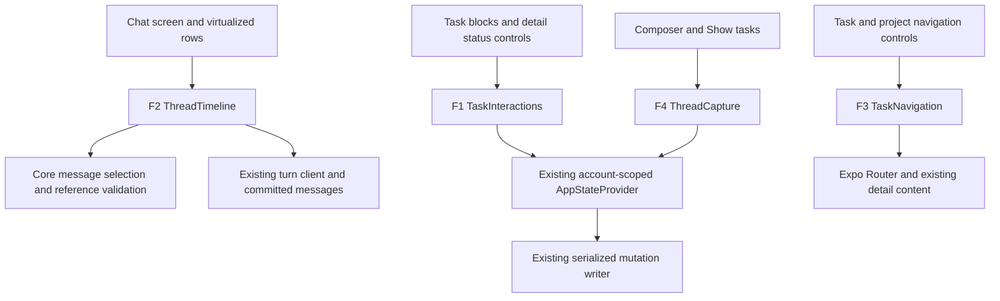

# Task widgets in the conversation

Planning date: 2026-11-10. Status: proposed implementation; documentation review
only. Extends the [private-alpha plan](private-alpha.md) and supersedes its
collapsing priority-list presentation. Existing storage, sync, turn, and native
acceptance gates still apply.

Cross-feature execution order is in the [next-build plan](next-build.md), N00–N05
for the initial conversation delivery and N10/N15 for player/sync integration.
W0–W6 below remain the detailed widget work references.

Companion acceptance contract: [Gurki specifications](../specs/thread-task-widgets.spec.md).
Facade IDs F1–F4, implementation IDs W0–W6, and scenario families WTW-01–WTW-26
are stable references for implementation and evidence. All facades below are
proposed; existing services are identified separately. The specs use Gurki v0.1,
including Output, Outcome, and Activates; they replace the earlier Cucumber-style
draft, which misinterpreted the requested language.

## Outcome and scope

The later [daily-stack/player plan](daily-stack-player.md) adds a separate Today
surface and durable planning/timing data. It composes with these widgets; it does
not restore a collapsing task section around chat. Both surfaces share task
identity and committed status, including stopping a run when chat completes it.
This plan's no-schema-migration scope applies to widgets alone, not to that new
daily-stack feature.

The home screen is a conversation. Replies can contain interactive task blocks;
the same task can appear in any number of replies. Completing or reopening one
copy updates every mounted copy and the task detail view through committed shared
state. Loading an older reply resolves its references against current task state.

Remove the expanding/collapsing task region, sticky task summary, priority-list
reading position, and completion-driven scroll jumps. Keep the composer, offline
manual capture, streaming/Stop/recovery, project and Matrix views, change summaries,
and whole-turn Undo. This is a presentation change, with no model-provider,
database-engine, sync-protocol, or event-version migration.

Success: render the same task in five replies; complete it in the first, reopen
it in the fourth, reload, and page away/back. Every copy must agree at each step.
Task title opens details over the thread; details link to the associated project.

## Current implementation and evidence

- [ChatDetailScreen](../../apps/mobile/src/features/chat/ChatDetailScreen.tsx)
  owns collapse, sticky-summary, and return-to-priority state.
- [TaskThread](../../apps/mobile/src/features/chat/TaskThread.tsx) uses a draggable
  list for current tasks but maps the entire history into its list header. Those
  history entries are not individually virtualized. Its assistant-message renderer
  and the streaming renderer explicitly pass `taskLinksOnly`, suppressing widgets.
- [RefUnfurl](../../apps/mobile/src/features/chat/RefUnfurl.tsx) already parses task
  references and contains interactive rows. Rows read the shared folded state and
  submit local commands. Pending state is per row; grouped lists move completed
  items into a different section and use task IDs as keys, which collide for
  repeated occurrences in one group. Missing tasks are dropped from grouped lists.
- [AppStateProvider](../../apps/mobile/src/state/atoms.ts) already owns tasks by ID.
  The [mutation writer](../../apps/mobile/src/application/mutations.ts) serializes
  snapshot → plan → commit → publish and checks session generations. Reuse it.
- [TaskSheet](../../apps/mobile/src/features/task/TaskSheet.tsx) already edits
  title, notes, status, dates, and project, and shows event history. Despite its
  name, the [route](../../apps/mobile/app/_layout.tsx) presents it as a pushed card.
  It displays the current project without a project navigation action.
- [ThreadComposer](../../apps/mobile/src/features/chat/ThreadComposer.tsx) creates
  tasks without a conversation receipt. Removing the live list therefore needs
  an explicit replacement for showing successful manual capture.
- [Core thread selection](../../packages/core/src/thread.ts) replays the complete
  journal and merges messages from existing chats with derived completion entries.
  [Local storage](../../apps/mobile/src/db/database.ts) also hydrates full history
  and refolds it on writes. A bounded UI window will not bound these storage costs.
- The [Worker turn implementation](../../apps/worker/src/agent/turn.ts) persists
  assistant messages as `msg_${turnId}_assistant`. The existing started frame
  supplies chat/turn identity; no new stream field is required to reconcile the
  transient reply with that durable message identity.

These are source findings, not new runtime verification. No app tests or device
acceptance were run for this documentation pass.

## Proposed interaction

A task block has a checkbox, readable title, and a quiet metadata line such as
`Website · Updated 10 Nov`. Show `No project` when unassigned. Use local calendar
dates from the task's `updatedAt`, with the year when needed; this means last task
edit, not message date. Keep the existing pine palette, light/dark themes, readable
column, and separate checkbox/title hit targets. No drag handle in chat blocks.

- **One entity, many appearances.** Blocks hold a task ID and occurrence identity;
  title, status, project, and updated date come from the account's current store.
  Do not copy entity state into message or row state. This matches React's
  [guidance on avoiding duplicate state](https://react.dev/learn/choosing-the-state-structure).
- **Stable replies, live task fields.** A reply keeps its original task IDs,
  order, and commentary. Completing a task fills its circle in place; it neither
  disappears nor moves into a new group. Newly matching tasks do not silently
  join an old list. A fresh request produces a fresh list. Prose and commentary
  remain historical even when a referenced task changes.
- **Explicit state changes.** Check sets `done`; uncheck sets `todo`. An
  `in_progress` task is unchecked with an in-progress label; completing then
  reopening it returns to `todo`. This is ordinary editing, without an Undo-reason
  dialog. Whole-turn Undo remains a separate action.
- **Commit before success.** Share pending state by task ID across thread copies,
  disable duplicate actions until that write completes, and publish checked state
  after local commit. Do not wait for network acknowledgement. On failure retain
  the committed state and show a retryable error. Clear/fence pending work on
  account changes. Preserve existing merge policy for concurrent device edits;
  this work does not introduce a new conflict-resolution scheme.
- **Details over the conversation.** Open the existing task route as a sheet on
  native and an overlay on web, backed by the same task ID. Provide Close, editing,
  history, and `Open project`. Close preserves scroll and draft. Project navigation
  dismisses the overlay before showing `/project/[id]/overview`; Back returns to
  the thread. Direct task links still work without a pre-existing thread route.
- **Unavailable entities.** Keep a disabled placeholder with the original label
  for missing tasks; deleted tasks show a deleted state and can open details for
  recovery. Archived projects remain identified. Never silently remove an
  occurrence or let a deleted task's checkbox reopen it.
- **A simple home.** Open at recent conversation, with no synthesized priority
  section or completion messages. Completion events remain in task history;
  persisted messages, including legacy-chat messages, remain accessible. Offer
  `Show tasks` as an explicit local action that appends an ordered reference list
  from current open tasks, so useful manual access does not require the agent.
  Bound each such list to 50 tasks and indicate when more remain, linking to
  Projects/Matrix rather than claiming it is exhaustive.

## Rendering, history window, and compatibility

Keep the existing persisted text and `[title](task:t_…)` reference format for the
first delivery. Standalone task references become blocks; consecutive references
form a list; prose references remain compact links. Accept common bullet/number
prefixes deterministically. Model output selects known entity references, while
the application owns the widget and its actions. No generated component code or
new general widget framework is needed. A structured message-parts schema can
wait until another widget type requires it.

Flatten message text segments and task occurrences into virtualized list items,
with keys containing chat ID, message ID, and occurrence index. A 200-task model
reply must not become one enormous, permanently mounted header or nested scroll
surface. Reuse `MessageWithRefs` parsing via a shared pure presentation parser;
keep domain reference validation in core. Existing text-only messages and
page/chat links must continue to render. Stream partial text/refs safely; enable
task controls when a complete valid ref resolves to committed local state.

Starting UI policy (engineering defaults to measure, not measured limits):

- Load the latest 50 messages; request 50 older/newer messages at a boundary.
  Retain at most 150 messages in the presentation window and virtualize the rows
  around the viewport. Track the in-flight turn separately so browsing older
  messages does not require retaining every message between there and the tail.
- Use a stable chronological cursor `(message.at, chatId, message.id)` for the
  existing merged conversation. Compare it consistently, dedupe by chat/message
  identity, and preserve an occurrence/offset scroll anchor when prepending or
  evicting. Avoid offset pagination and never evict the visible message. Represent
  an off-window active turn with the new-message indicator rather than stretching
  the retained window to reach it.
- When browsing old messages, show `Jump to latest`/new-message indication. New
  replies and task edits must not force-scroll the reader. Follow streaming only
  when already at the bottom or after the user explicitly sends a message.
- Evicted rows lose subscriptions, not entity truth. Remounting any old occurrence
  resolves current state, with the same behavior as recent widgets. A UI window
  is not a time limit after which widgets become stale.

React Native documents finite render windows and the need to keep durable item
state outside virtualized cells in [VirtualizedList](https://reactnative.dev/docs/virtualizedlist).
Use the simplest existing compatible list primitive; a standard FlatList is the
baseline. Do not add a dependency for this change. Test against the installed
React Native `0.88.0-rc.3`, React `19.3.0`, and Expo `58.0.6`.

The first delivery may page over the already hydrated local message collection.
It must be described as **bounded presentation**, not bounded database hydration
or infinite-history performance. Indexed message projection reads and incremental
folding are a separate storage follow-up coordinated with the
[storage plan](storage-and-dx.md); no server history endpoint is needed for local
widgets. Preserve the full journal, outbox, undo provenance, and v1 readers.

## Key facades and contracts

These four facades simplify concrete existing subsystems for UI callers. They
are local module boundaries, not new network services or new sources of task
truth. Names and paths marked proposed do not exist yet. Operation tables define
the semantic contract; W0 turns them into TypeScript shapes using existing core
IDs, schemas, and mutation outcomes. Do not add placeholder classes, a generic
repository, or a new dependency to implement these boundaries.

| Facade | Consumers | Wraps | Proposed location |
| --- | --- | --- | --- |
| F1 `TaskInteractions` | Task blocks and detail status controls | Shared committed store, per-task pending coordination, existing mutation writer | `apps/mobile/src/application/taskInteractions.ts`; React adapter `src/features/task/useTaskInteraction.ts` |
| F2 `ThreadTimeline` | `ChatDetailScreen` and the replacement thread list | Message selection, reference parsing, window state, streamed-to-durable reconciliation | `apps/mobile/src/features/chat/useThreadTimeline.ts`; pure selection in existing core `thread.ts`; proposed mobile `messageParts.ts` |
| F3 `TaskNavigation` | Task title links, task detail Close/Open project | Expo Router task/project routes and platform presentation | `apps/mobile/src/features/task/useTaskNavigation.ts`, existing task route and root stack |
| F4 `ThreadCapture` | `ThreadComposer` and local Show tasks action | Existing atomic command batches and reference formatting | `apps/mobile/src/application/threadCapture.ts` |

### F1 — TaskInteractions

Purpose: every copy of a task uses the same committed record and the same pending
status operation. Existing provider: `AppStateProvider.updateTask` and
`createLocalMutationWriter`; do not replace their serialization or sync path.

| Operation | Input | Output / failure |
| --- | --- | --- |
| `read` | Task ID, current committed task/project maps | `available`, `deleted`, or `missing`; available/deleted records include current entity fields. Pending state and safe error are separate presentation fields. |
| `setStatus` | Task ID and explicit desired `TaskStatus` | Existing `updated` / `noop` outcome; an already-pending operation reports `busy` without submitting another write; missing/deleted widget targets report `unavailable`. Preserve writer failures and their codes. |

The functional React adapter subscribes to the existing store plus a shared
interaction coordinator. One coordinator lives for the account session, created
at provider composition, not once per hook/widget. Key pending entries by account
generation and task ID; release them on success/failure and discard old-generation
completions/errors on account switch. Only pending/error state lives here; task
status is never optimistic row state. Unmounting a row does not cancel a committed
or pending application mutation. Non-status detail edits continue through existing
mutation methods; they must not create another copy of the entity.

Failure behavior: a failed write leaves every copy at the previous committed
state, clears pending controls, and exposes a safe retry action. `noop` writes no
event. A second action after the first commit reads the newly committed state;
it never replays a captured toggle. Widget operations never send `deleted: false`;
recovery is an explicit detail action. This facade is a client adapter over the
existing Promise-based store, not a new neverthrow/HTTP boundary.

### F2 — ThreadTimeline

Purpose: the thread screen consumes a bounded sequence of render rows without
knowing journal replay, cursor mechanics, or task-reference parsing. Core owns
pure message ordering/window selection; mobile owns parsing into presentation
parts, viewport state, and existing stream integration.

| Operation | Input | Output / failure |
| --- | --- | --- |
| `snapshot` | Current committed chats, window bounds, optional active turn | Ordered rows, older/newer boundary cursors, `hasOlder`, `hasNewer`, pending-turn/new-message indication. Rows contain task IDs and original labels/commentary, not task snapshots. |
| `pageOlder` / `pageNewer` | Current boundary cursor and visible anchor | Up to 50 adjacent messages, deduped/trimmed to the 150-message window; empty page at an exhausted boundary. |
| `reportViewport` | Visible row key, pixel offset, near-bottom flag | Updated anchor/follow policy; no domain mutation. |
| `jumpToLatest` | Explicit user intent | Latest window and scroll intent; no new model call or message. |

Data contracts: `MessageKey = (chatId, messageId)`;
`MessageCursor = (at, chatId, messageId)` ordered lexicographically by the same
comparator in every direction; `RowKey = (MessageKey, partIndex, occurrenceIndex)`;
`ViewportAnchor = (RowKey, offsetPx)`. Encode keys without concatenation ambiguity.
Row variants cover message metadata, text/inline parts, task occurrences, and
page/chat references. Keep task rows individually virtualizable even within a
large reply. Date grouping and author labels remain presentation concerns.

Message parts depend only on message text/identity, not current task status.
Reuse core `parseRefHref`; invalid IDs/syntax stay plain text, valid unresolved
IDs stay visible as unavailable references. Never merge duplicate task
occurrences. A partial streamed ref remains text until complete and valid.
Reconcile the transient reply using turn/chat/message identity from the existing
turn lifecycle, not text equality; replace it once with the durable reply.
Use the existing `msg_${turnId}_assistant` identity rule; place any shared pure
formatter in core rather than independently redefining it in UI and Worker.
Row keys must not change merely because a task was checked or renamed.

Lifecycle/failures: own the window for the mounted thread/account, preserve it
under task edits and overlay presentation, reset it on account switch. The first
adapter reads hydrated committed state; it exposes storage readiness/error rather
than manufacturing an empty ready thread. Preserve the existing legacy-chat
merge scope and v1 message readers. No offset-based remote API, independent
entity cache, or journal refold is added by this facade.

### F3 — TaskNavigation

Purpose: callers open and leave task details without knowing platform-specific
overlay rules or reconstructing the navigation stack.

| Operation | Input | Output / failure |
| --- | --- | --- |
| `openTask` | Task ID and origin route/focus target | Existing task route presented over its origin; checked state is unchanged. |
| `closeTask` | Current task route and origin, if present | Dismiss to origin and restore focus; direct-link fallback goes home. |
| `openProject` | Associated project ID from current committed task | Dismiss task overlay, then open project overview; Back returns to the originating thread when opened there. Unassigned/missing project has no enabled action. |

Lifetime: use the navigation tree; retain the thread component/window/draft
behind the overlay. Keep task IDs in routes, not serialized task objects. Link
entry points from Projects/Matrix still return to their own origins. Deleted
tasks can open recovery; a missing task opens a safe unavailable view. Support
native dismissal/Back, web Close/Escape/focus, and a direct task URL with no prior
screen. Existing `TaskSheet` remains the detail content owner.

Expo documents that `modal`/`formSheet` alone render regular routes on web;
verify the installed router and implement the overlay explicitly, following
[Expo's web-modal guidance](https://docs.expo.dev/router/advanced/web-modals/).

### F4 — ThreadCapture

Purpose: manual capture has durable visible results after the global priority
region is removed. Reuse `executeLocalCommands`; this is one simplified entry
point for assembling the existing task/message batch, not a second writer.

| Operation | Input | Output / failure |
| --- | --- | --- |
| `captureTask` | Title, optional project ID, supplied task/message identities | Committed task ID and receipt message identity, or existing mutation failure. Ensure the permanent chat and commit task creation plus its system reference receipt in one batch. |
| `showTasks` | Explicit user action and the current committed open-task selection | Committed system message identity, included count, and remaining count. Snapshot IDs/order at invocation, cap at 50, and record an empty/truncated explanation where applicable. |

Generate IDs once per submission in the caller, retain them through a retry,
and clear the input only after commit. Do not start an agent turn or attribute
system receipts to the assistant. A Show tasks reply freezes the IDs selected
at invocation; future entity edits remain live through F1. It does not rerun the
selection whenever state changes. Project creation/capture and dictation retain
their existing behavior. Actor, account fences, atomic persistence, and sync
publication stay owned by the existing application writer.

### Composition and dependency rules

Coordinator-owned composition changes: `state/atoms.ts`, root stack/routes,
core exports, shared DTOs, and this interface register. This plan does not
authorize parallel edits or create file leases. Reuse functional components and
`src/ui`; do not introduce `useMemo`/`useCallback` as a default.

No new public transport contract is required. Keep Effect inside domain and
application code, and preserve neverthrow Result at existing API boundaries.
Core imports only Effect and its own modules. Existing shared never-rest
contracts and streaming host lifecycles remain unchanged. The Worker prompt
only recommends reference layout; the deterministic parser and current entity
store decide what can render and mutate.

## Implementation tasks

- [ ] **W0 — Implement facade data contracts and acceptance fixtures.** No
  prerequisites. Translate F1–F4's operation/data contracts into types in their
  owning modules, reusing core IDs and existing writer failures. Establish typed
  message/task fixtures for the companion Gurki scenarios without adding a Cucumber
  runtime or placeholder services. Establish reproducible development-only Gurki
  lint/encode tooling from a verified release or the pinned source revision below;
  keep it out of core/mobile runtime dependencies. Root manifest/lockfile wiring
  remains coordinator-owned. Confirm account-scoped coordinator composition,
  retained route behavior, and existing stream message identity before dependent
  wiring. Evidence: types and fixtures compile; scenario IDs map to focused tests
  or explicit device/manual checks. Contract definition does not mark acceptance
  as passed.
- [ ] **W1 — Deterministic message model.** Depends on W0. In core `thread.ts`
  and the mobile reference parser, separate conversation messages from synthesized
  completions, define cursor ties and ordered occurrence parsing. Preserve legacy
  chats and existing message identity. Evidence: fixtures for equal timestamps,
  bullet lists, repeated IDs within one message, malformed refs, and page/chat links.
  Delivers F2's pure inputs; covers WTW-03, WTW-09, WTW-11, WTW-15, WTW-22.
- [ ] **W2 — Shared live task blocks.** Depends on W1. Extract a reusable block
  from `RefUnfurl.tsx`; show project/updated date, stable rows, missing/deleted
  states, and F1's account-scoped per-task pending/error coordination. Keep
  `state/atoms.ts` the committed source; use the existing mutation writer. Evidence:
  five rendered copies agree after complete/reopen/rename/project change; failed
  commit publishes nothing; rapid cross-copy taps cannot race a pending action.
  Covers WTW-01–WTW-09 and WTW-25; WTW-24 integration follows in W6.
- [ ] **W3 — Windowed conversation.** Depends on W1/W2. Replace `TaskThread`'s
  draggable task region/header history with individual virtualized rows and the
  50/50/150 message window through F2. Wire `ChatDetailScreen` without collapse,
  sticky-summary, completion-reveal, or priority-spacer state. Evidence: page both directions,
  preserve visible anchors, remount fresh widgets, keep reader position during
  edits/streaming, and recover an active turn without duplicate messages.
  Covers WTW-04, WTW-08, WTW-10–WTW-14, WTW-22–WTW-23, and WTW-26.
- [ ] **W4 — Task detail overlay and project navigation.** Depends on W2. Adapt
  `TaskSheet`, its route, and stack presentation through F3; retain editing/recovery
  and add `Open project`. Evidence: native/web close/Back/Escape, keyboard/focus behavior,
  direct task URL, unassigned/deleted task, project navigation, and thread draft/
  anchor preservation. Reuse existing `src/ui` controls and functional components.
  Covers WTW-16–WTW-18 and the detail path in WTW-09.
- [ ] **W5 — Entry points and durable receipts.** Depends on W1–W3. Update
  `ThreadComposer` task creation through F4 to include a system reference receipt
  in the same atomic command batch. Add bounded local `Show tasks`, including
  empty/truncated results. Retain project capture, dictation, and capture-sheet flows; stop passing
  `taskLinksOnly` where widgets are intended. Clarify reference layout in the
  existing Worker turn prompt. Evidence: offline task creation visibly succeeds,
  receipts survive reload, failed storage leaves input intact, and streamed refs
  become the same durable widget occurrences without double rendering.
  Covers WTW-19–WTW-22.
- [ ] **W6 — Integration and delivery evidence.** Depends on W3–W5. Add focused
  React/store tests using the existing happy-dom pattern, run affected tests and
  `pnpm --filter @yatma/mobile typecheck`; run core checks for W1 and Worker checks
  for prompt changes. Record web and native results separately. Remove unused
  thread-only controls/helpers only after checking their consumers. Update product,
  interface, and private-alpha implementation status after actual verification.
  Close every scenario's evidence entry, especially recovery, Undo provenance,
  account isolation, and native viewport behavior. Run the existing dependency
  boundary check after wiring; no implementation checkbox is complete from prose.

## Gurki acceptance contract and test mapping

The [Gurki source](../specs/thread-task-widgets.spec.md) is canonical. Its
frontmatter identifies a draft spec, and `System:` groups its named scenarios.
Each scenario distinguishes immediate behavior (`Then`), produced artifacts or
transfers (`Output`), lasting state/capability changes (`Outcome`), and named
possible next scenarios (`Activates`) where useful. `But` records the remaining
strain in failed-save and full-journal paths. This follows the
[Gurki v0.1 specification](https://gurki.nz/spec) and
[workbench](https://gurki.nz/workbench).

Gurki v0.1 does not support Scenario Outlines or Cucumber tags. The former table
cases are explicit scenarios: 26 stable WTW families now contain 43 scenarios,
including separate partial/resolved/durable streaming paths. IDs are in scenario
titles; `# Facades:` / `Tasks:` comments provide traceability. The mapping below
applies to every suffixed case in each family. Test fixtures supply valid IDs,
fixed clocks, and timezones; authored timing stays relative.

Use Gurki lint and encode to validate the language/schema. Generated JSON IR is
temporary interchange, not the authored specification. Gurki decode generates
the System Outputs/System Outcomes report from scenario steps; do not maintain
that report by hand. These scenarios are alternative acceptance paths, so the
derived listing is not an aggregate deployment count or a net-value claim.
No AI analysis sidecar, net ledger, or simulation engine is required here.

**Verification boundary:** Gurki validates the specification; it does not run
the app. Existing `vite.config.ts` runs `.test.ts` files with Vitest. Implement
the behavioral cases as named Vitest tests with their full WTW IDs, and retain
platform checks as manual/device evidence. Do not claim `pnpm test` executes
`.spec.md` scenarios or add Cucumber step definitions.

Validation evidence for this documentation pass:

- The documented npm package lookup returned 404. The verified fallback was
  [Gurki source revision d1b1f7f](https://github.com/danalexilewis/gurki/tree/d1b1f7fad53fc5c880a23faccd9007cdce7fa250),
  whose package declares version `0.1.0`. It ran from a temporary checkout through
  `tsx` `4.20.3`; Yatma manifests and lockfile were not changed.
- Upstream `lint` on the final `.spec.md`: **0 errors, 0 warnings**.
- Upstream `encode` → `decode` → `encode`: all 43 scenario titles, resolved
  step kinds/text/connectors, and facade/task comments were preserved. Every
  scenario has Given, When, Then, Output, and Outcome; all authored Activates
  targets resolve. Decode generated the System Outputs/System Outcomes listing.
- This is language/schema validation, not application acceptance. No task UI,
  facade implementation, device behavior, or application tests were run here.

W0 must make the chosen development-only runner reproducible for future
contributors; Gurki is not yet installed in Yatma. Once available, the upstream
CLI operations are `gurki lint <spec>`, `gurki encode <spec> --out <temporary.json>`,
and `gurki decode <temporary.json> --out <spec>`. Do not assume a successful npm
installation until a release or the pinned-source build is verified.

| Scenarios | Boundary / task | Planned verification and location | Current evidence |
| --- | --- | --- | --- |
| WTW-01–WTW-09, WTW-25 | F1; W2, with W1 parser inputs | Proposed `apps/mobile/src/application/taskInteractions.test.ts` and `src/features/chat/TaskBlock.test.ts`; exercise real coordination and writer behavior with controllable storage. Include duplicate rows, failed writes, date/timezone fixtures, and session fences. | Not implemented / not verified |
| WTW-03, WTW-09, WTW-11, WTW-15, WTW-22 | F2 pure parts; W1 | Extend existing `packages/core/src/thread.test.ts`; proposed `apps/mobile/src/features/chat/messageParts.test.ts`. Cursor ties, legacy identities, grammar fallbacks, and partial references are deterministic fixtures. | Not implemented / not verified |
| WTW-04, WTW-08, WTW-10–WTW-14, WTW-22–WTW-23, WTW-26 | F2; W3/W6 | Proposed `apps/mobile/src/features/chat/threadTimeline.test.ts`; reuse existing turn-client fixtures. Record actual web/native anchor behavior and mounted-row counts for WTW-13/14 separately from pure selector tests. | Not implemented / not verified |
| WTW-09, WTW-16–WTW-18 | F3; W4 | Proposed `apps/mobile/src/features/task/TaskSheet.test.ts` for actions/state; web keyboard/focus/direct-link checks plus iOS sheet and Android Back evidence. Recheck Projects/Matrix task links return to their origin. | Not implemented / not verified |
| WTW-19–WTW-21 | F4; W5 | Proposed `apps/mobile/src/application/threadCapture.test.ts`; extend existing mutation/storage tests to fail different parts of a real atomic batch. Capture and receipt must both roll back. | Not implemented / not verified |
| WTW-23–WTW-24 | Existing turn/undo services plus F1/F2; W6 | Extend existing mobile `sync/chatClient.test.ts` and `application/mutations.test.ts`; integrated restored-turn/full-batch Undo check after reload. Include later writes returning a status to its earlier value. | Not implemented / not verified |

Record future evidence as `scenario ID / environment / test or manual procedure /
result / limitations`. A unit test does not establish two-device sync, native
SQLite, Cloudflare deployment, or native gesture/navigation acceptance. Keep the
private-alpha gates open until their existing acceptance requirements are met.

## Basic risks

Qualitative likelihood/impact estimates before implementation:

| Risk | Likelihood | Impact | Mitigation and task | Remaining concern |
| --- | --- | --- | --- | --- |
| Per-row snapshots/pending flags let repeated copies disagree or race. | Medium | High | One committed entity source and shared pending coordination; W2. | Concurrent devices still use existing merge semantics. |
| Completion regrouping or prepend eviction shifts the reader's target. | High | Medium | Stable occurrence order/keys, anchored windowing; W1/W3. | Variable-height streaming needs native checks. |
| Rendering window is mistaken for bounded history/storage cost. | High | Medium | Document hydration limit; measure long-history behavior; W3/W6. | Full journal hydration/refolding remains until storage follow-up. |
| Removing the live list hides manually created tasks or loses discoverability. | High | Medium | Atomic task receipt and local Show tasks; W5. | Manual drag priority editing outside chat remains a later UX decision. |
| Overlay routes lose draft/scroll, trap focus, or strand direct links. | Medium | Medium | Reuse route/content; explicit native/web/deep-link checks; W4. | Web evidence cannot establish native dismissal behavior. |
| Invalid/stale refs disappear or mutate an unavailable task. | Medium | Medium | Fallback/deleted states and no invalid actions; W1/W2. | A missing entity may resolve after later sync. |

## Validation, delivery, and open decisions

Demonstrate the five-copy scenario offline, after reload, after paging an old copy
out/back, and after a remote committed update. Include delayed writes, failed
SQLite commits, account switches, duplicate IDs within a reply, and an
`in_progress` task. Demonstrate large replies (up to the existing tool's 200-task
limit) as individually virtualized occurrences. Use a long seeded history to
observe retained-message and mounted-row counts; record device/fixture/timings
rather than inventing a performance guarantee. Exercise streaming, Stop/recovery,
change-summary Undo, dictation, and project/Matrix entry points as regression flows.

Deliver the UI change together with manual receipts and history windowing. No data
rewrite is needed; reverting the presentation keeps tasks, stored messages, and
journal data readable. Do not remove legacy data readers as cleanup.

No blocking product decision is required to begin. Suggested defaults above are
explicitly proposed: stable list membership, reopening to `todo`, no standalone
completion feed, and a 50/50/150 UI window. Tune window sizes from evidence. A
dedicated global manual priority/reorder surface and structured message parts
can be designed later; neither should recreate the collapsing region in chat.
Choosing a newer model is outside this UI review.

Sources consulted on 2026-11-10: repository files linked above; React state
structure (shared entity identity); React Native VirtualizedList (render window
and external state); Expo web modals (platform-specific overlay behavior);
Gurki language specification and workbench (source envelope, distinct step
kinds, supported syntax, derived reports, and validation commands).
Product interaction choices and numeric window defaults are design judgment,
not requirements asserted by those sources.
