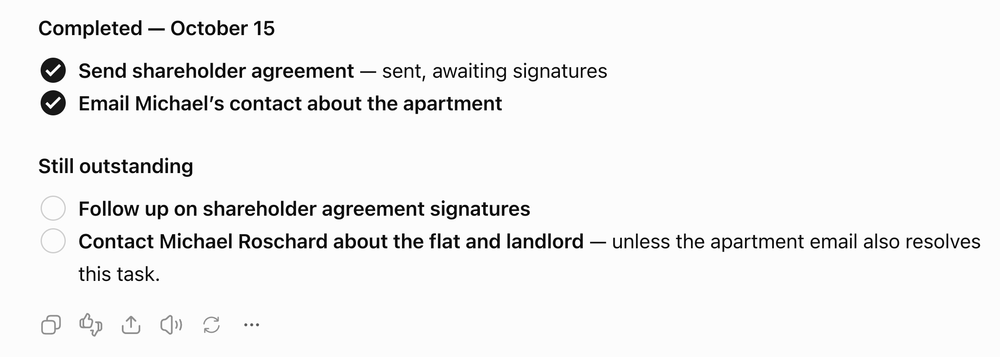

# Yatma — product

Yet Another Task Management App: an iOS-first Expo client, a Cloudflare Worker, and a shared `core` package.

## Outcome

- **Tasks by touch.** Gestures in the style of 30/30 and a TickTick-style Eisenhower matrix.
- **Tasks by voice or chat.** A cheap agent answers questions about past tasks and applies several changes from one dictated sentence.
- **Curated knowledge.** The agent keeps a Brief and a Handbook for each project (plus a personal “Me” brief).
- **Live cards in chat.** Replies embed cards that open the dedicated task, page, and list screens.

## Principles

- **Good without the agent.** Task management must work great by hand. The agent speeds things up; it does not replace the UI.
- **Every change is an event.** Each event records who made it (actor) and why (reason). Reasons are optional for you and required for the agent. History, Undo, and “why did this move?” come from those events.
- **Apply first, undo later.** The agent applies changes immediately. Each agent turn is one undoable batch—no confirm dialogs.
- **Cards stay live.** Chat cards reference tasks and pages instead of copying them, so they always show current state.
- **Curated context.** The agent sees a Brief, open tasks, and pinned pages—not an ever-growing transcript.

## Tasks inside chat

Visual direction supplied on 2026-10-15. This is the target presentation for U1;
the chat renderer has not yet been updated to match it.

- **Flat, readable task lists within the reply.** Use short section headings such
  as “Completed — October 15” and “Still outstanding”, with generous separation
  between groups and compact spacing between task rows.
- **A status circle beside each task.** Open tasks have a thin neutral outline;
  completed tasks have a filled foreground circle with an inverse checkmark.
  Completed titles remain readable without a strike-through.
- **Clear type hierarchy.** Task titles are bold. Optional assistant commentary
  follows an em dash in regular weight. Wrapped text aligns with the title,
  leaving the status-control gutter clear.
- **Direct manipulation.** Tapping the circle completes or reopens the task;
  tapping the title opens its task sheet. Give the visible circle a generous
  touch target and expose its checked state and task title to accessibility tools.
- **Live entity references.** Render titles and status from local task state using
  stable task IDs. Status-based groups follow current state; assistant commentary
  remains historical message text. Format completion dates in the user's local day.
- **Use the existing application path.** Status changes use the same offline
  mutation writer as the dedicated task screen, with visible persistence failures.
  Unknown references remain plain text. The screenshot is a visual reference,
  not task data to import.
- **Keep change summaries distinct.** The turn's durable change summary and Undo
  accompany these live rows. Apply the existing theme and UI components in light
  and dark mode; the chat response action icons shown in the reference are not
  part of this task-list requirement.

## Local-first and sync

- The phone keeps an append-only event log in `expo-sqlite`. Task management works offline; chat needs a connection.
- One Cloudflare Worker plus one Durable Object per user (`UserSpace`) owns that user’s log, runs the agent, and schedules curation.
- Transport is Effect RPC over a hibernating WebSocket. The Worker checks the Clerk token on connect, then forwards to the user’s `UserSpace`.
