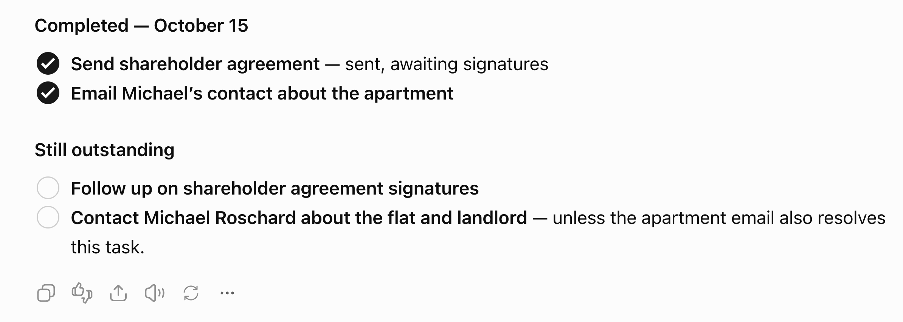

# Yatma — product

Yet Another Task Management App: an iOS-first Expo client, a Cloudflare Worker, and a shared `core` package.

## Outcome

- **Plan through conversation.** Talk with Yatma to work out a manageable stack for the day.
- **Work through Today.** Arrange chosen commitments and enter a dedicated focus scene with simple work controls.
- **Tasks by voice or chat.** A cheap agent answers questions about past tasks and applies several changes from one dictated sentence.
- **Curated knowledge.** The agent keeps a Brief and a Handbook for each project (plus a personal “Me” brief).
- **Live task widgets in chat.** Replies embed task blocks with working checkboxes;
  task details open over the conversation and link to the associated project.
- **A playable day.** Arrange today's task stack, load an opening routine, and
  press Play to track work, adapt estimates, and make room for micro breaks.

## Principles

- **Good without the agent.** Task management must work great by hand. The agent speeds things up; it does not replace the UI.
- **Every change is an event.** Each event records who made it (actor) and why (reason). Reasons are optional for you and required for the agent. History, Undo, and “why did this move?” come from those events.
- **Apply first, undo later.** The agent applies changes immediately. Each agent turn is one undoable batch—no confirm dialogs.
- **Cards stay live.** Chat cards reference tasks and pages instead of copying them, so they always show current state.
- **Curated context.** The agent sees a Brief, open tasks, and pinned pages—not an ever-growing transcript.

## Tasks inside chat

Product direction and local implementation updated on 2026-11-11. The home tab is one permanent chat
thread; there is no chat list, separate Chat tab, or new-conversation flow.
The implemented local surface replaces the earlier collapsing priority-list design.
See the [next-build execution ledger](plans/next-build.md#execution-ledger--2026-11-10)
for tested behavior and outstanding native/cloud acceptance.

- **Conversation is the home surface.** Open at recent conversation. Task lists
  appear as blocks inside replies, with no separate expanding task region or
  sticky priority summary. Existing conversation messages remain accessible.
- **Many appearances, one task.** The same task may appear in several replies.
  Every occurrence reads current shared task state. Checking one completes the
  task everywhere; unchecking another reopens it everywhere. Manual changes commit
  locally and work offline; remote updates use the existing sync path.
- **Stable lists with live fields.** Each reply retains its task membership,
  order, and commentary. Completion changes the circle in place; it does not
  remove or regroup the row. Titles, status, project, and updated date stay live.
  A new list request can return a different selection. Event-time completion
  records remain available in task details.
- **Details stay close.** Show a checkbox, title, project (or No project), and
  last-updated calendar date. Selecting the title opens a detail sheet/dialog
  over the conversation, with editing, history, recovery, and Open project.
  Closing it preserves the thread's reading position and draft.
- **Projects remain the grouping model.** A task belongs to one project or stays
  unassigned. Project views remain available independently of chat. The matrix
  navigation and urgency/importance editor are removed; stored legacy fields remain
  readable. Task blocks have no drag handles.
- **Conversation is the query and planning layer.** Ordinary text goes to the LLM.
  `/list` lists every open task locally, including offline. `@` searches committed
  tasks and projects, inserting references with stable identity. Task/project
  mentions resolve live names and open the existing detail views. There is no
  Message/Task/Project mode selector or Projects/Matrix shortcut above the input.
  Direct task capture remains available from New task. Messages and local command
  results commit before the input clears; failures retain the draft.
- **Choose the day together.** The model can inspect the backlog and a calendar
  day's entries, allocations, recorded intervals and preferences. Explicit daily
  changes use one atomic `plan_day` batch; discussing a suggestion does not add
  commitments. Device planning date/timezone travels with the turn. The model
  uses existing briefs/history as evidence and asks when preferences are unknown.
  Automatic preference learning and proactive morning delivery are future work.
- **Bound the presentation.** Page older messages and virtualize task occurrences.
  A task loaded from old history still resolves current state. Preserve the
  reader's position during edits and new replies, with a Jump to latest action.
  The implemented starting window is 50 messages per page and 150 retained messages;
  these are tuning defaults, not verified performance limits. Database hydration
  and model context have separate bounds and workstreams.
- **Quiet, readable rows.** Use the existing pine palette and system type in light
  and dark mode, with a narrow readable column on larger screens. Open circles
  are outlined; completed circles are filled. Titles remain readable without
  strike-through. Standalone task references become interactive blocks; prose
  references remain compact links. Repeated task appearances are intentional.
- **Preserve the application path.** All manual writes use the atomic offline
  mutation service and show save failures. Keep agent change summaries and Undo
  distinct from task status edits. Agent responses still require a connection.

Existing project assignments are preserved. Legacy headings and tags become
projects, reusing active projects with the same normalized name. An unassigned
task with one distinct tag gains that project; tasks with several tags remain
unassigned. The atomic conversion retains old values in the event journal.
Verification is recorded in the private-alpha plan; web preview evidence does
not establish native gesture or dictation acceptance.

## Daily stack and player

Local implementation delivered; device/backend acceptance remains pending. See the
[daily-stack plan](plans/daily-stack-player.md) and
[Gurki acceptance model](specs/daily-stack-player.spec.md).

Today is a dedicated ordered work stack with Play/Pause, basic allocations,
actual time, and a forecast of what follows. Chat remains a conversation; both
surfaces reference the same durable tasks. Today's order is independent of global
task priority, and a time allowance expiring never marks a task done.

Extend an allocation to push later projected times back, move an unfinished item
to the bottom for another attempt today, or defer it to the top of tomorrow's work
queue. Preserve actual time, task/project identity, context requirements, and due
dates. Removing a task from today does not delete it or create an automatic next-day
commitment. Priority, scheduled dates and genuine deadlines inform what to work on.

Templates pattern the opening, followed by the remaining tasks in their existing
order. The admin example is **10 minutes mindfulness → 5 minutes reprioritisation
→ 30 minutes clear email → remaining queue**. An explicitly loaded preparation
routine can precede carried work; deferred tasks keep priority within the work queue.
Template instantiation and today's later edits must not rewrite past days.

Opening Today preserves carried work and instantiates the chosen opening routine
once. It does not silently add the backlog. Tasks enter the stack through explicit
manual selection, a loaded routine, or a requested LLM plan change. Automatically insert breaks every two
hours of planned work by default, with configurable interval, duration, and off
switch, so the day is ready to play. Tasks and breaks remain reorderable; insert,
resize, skip, or remove a break manually without automation immediately restoring
it. Reopening Today preserves those edits. Break time is separate from work time;
skipping a break does not count as rest. Estimates carry no failure penalty.

Focus mode is the sole player surface. On desktop, the timer, current task,
scrollable upcoming stack and end forecast occupy the left third; full-height
ambience fills the right two thirds. Task titles open the same detail dialog used
elsewhere. Basic controls play/pause, adjust allocation and finish the current
item. On mobile, the scene fills the screen with current-task controls at the
bottom; scrolling continues into the upcoming stack below the scene. Today retains
planning/adaptation actions. There is no separate floating player or compact dock.

Original bundled forest, rainy-window and coast scenes accompany continuous
forest/rain/ocean soundscapes. A sliding scene chooser controls scene, gain and
mute independently of work state. Focus entry uses a restrained slide/fade and
honors reduced motion. Desktop has a collapsible workspace menu and keyboard
quick switch; narrow layouts keep touch navigation.

## Projects and priorities

Tasks is a standalone workspace destination for all tasks, including tasks with no
project and tasks in archived projects. It supports search, status/project/date
filters, priority/title/due-date/recent-update sorting, bulk project assignment,
and adding tasks to Today. Creating a task here requires no project. Routines has
its own workspace destination for reusable stacks and daily routine preferences.

Projects are optional collections of tasks and open at their task list. The same
catalog controls work within a project. The overview remains available for
completion progress, outstanding/overdue counts, the next seven days and tasks
without dates, plus name, purpose, color, target date and bookmarks. Task details
provide due-date editing. Project properties, bookmarks and due dates enrich the
bounded model/context preview.

Project sharing is future scope, not an implemented capability. Sharing will be
project-scoped; it must not implicitly expose unassigned tasks, personal Today
plans or the rest of an account. See the future sharing boundary in
[internals/interfaces.md](internals/interfaces.md#future-project-sharing-boundary).

The prioritisation matrix is out of the current product surface. Existing matrix
URLs redirect to Today. Historical quadrant/order data remains readable without
exposing matrix controls or forcing a data migration.

## Local-first and sync

- The phone keeps an append-only event log in `expo-sqlite`. Task management works offline; chat needs a connection.
- One Cloudflare Worker plus one Durable Object per user (`UserSpace`) owns that user’s log, runs the agent, and schedules curation.
- Transport is Effect RPC over a hibernating WebSocket. The Worker checks the Clerk token on connect, then forwards to the user’s `UserSpace`.

## Scheduling and importance

Task detail has a Priority dropdown (High, Medium, Low, No priority). Scheduled date
means when to work; Due date is an optional actual deadline. Today sets the local
calendar date, This week sets Sunday, Next week sets the following Monday, and
Later clears the schedule. Exact scheduled dates are editable. Scheduling a task for today automatically includes it in the Today stack. Schedule
changes never change a deadline.
Existing due dates retain their meaning; no deadline is silently migrated.

The Tasks catalog filters schedules by Today/This week/Next week/Later and sorts
by scheduled date independently of deadline. Priority sorting puts overdue/today
deadlines first, then importance, deadline, schedule and manual order. Today
retains explicit drag ordering. Place and Mental mode are removed from task UI
and planning context; old stored fields remain readable for compatibility.

Add to Today commits the task's scheduled date to today together with its daily
entry. The same button becomes Unschedule from Today. Clearing the schedule (or
moving it away from today) removes pending Today entries and closes active work
without deleting recorded intervals, task history or the deadline. Due date has
no quick-select buttons in task detail; the scheduled-date input has a clear action.

Today task membership is derived from `scheduledDate`. Daily entries retain only
execution details (position, allocation and intervals); their task membership is
reconciled by the shared planner. Tasks scheduled before a day is opened appear
when it is opened. Clearing/moving the date removes pending entries, while
rescheduling revives their saved execution state. Activities/routines still have
their own daily entries. Existing unscheduled pending task entries are removed
when their day is reconciled, retaining history and recorded work.
