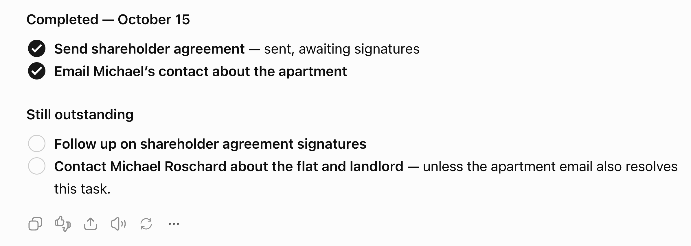

# Yatma — product

Yet Another Task Management App: an iOS-first Expo client, a Cloudflare Worker, and a shared `core` package.

## Outcome

- **Tasks by touch.** Gestures in the style of 30/30 and a TickTick-style Eisenhower matrix.
- **Tasks by voice or chat.** A cheap agent answers questions about past tasks and applies several changes from one dictated sentence.
- **Curated knowledge.** The agent keeps a Brief and a Handbook for each project (plus a personal “Me” brief).
- **Live task widgets in chat.** Replies embed task blocks with working checkboxes;
  task details open over the conversation and link to the associated project.
- **A playable day.** Arrange today's task stack, load an opening routine, and
  press Play to track work, adapt estimates, and make room for micro breaks.

## Principles

- **Good without the agent.** Task management must work great by hand. The agent speeds things up; it does not replace the UI.
- **Every change is an event.** Each event records who made it (actor) and why (reason). Reasons are optional for you and required for the agent. History, Undo, and “why did this move?” come from those events.
- **Apply first, undo later.** The agent applies changes immediately. Each agent turn is one undoable batch—no confirm dialogs.
- **Cards stay live.** Chat cards reference tasks and pages instead of copying them, so they always show current state.
- **Curated context.** The agent sees a Brief, open tasks, and pinned pages—not an ever-growing transcript.

## Tasks inside chat

Product direction updated on 2026-11-10. The home tab is one permanent chat
thread; there is no chat list, separate Chat tab, or new-conversation flow.
The target below replaces the earlier collapsing priority-list design. See the
[task-widget implementation plan](plans/thread-task-widgets.md) for proposed
interfaces, tasks, and acceptance evidence.

- **Conversation is the home surface.** Open at recent conversation. Task lists
  appear as blocks inside replies, with no separate expanding task region or
  sticky priority summary. Existing conversation messages remain accessible.
- **Many appearances, one task.** The same task may appear in several replies.
  Every occurrence reads current shared task state. Checking one completes the
  task everywhere; unchecking another reopens it everywhere. Manual changes commit
  locally and work offline; remote updates use the existing sync path.
- **Stable lists with live fields.** Each reply retains its task membership,
  order, and commentary. Completion changes the circle in place; it does not
  remove or regroup the row. Titles, status, project, and updated date stay live.
  A new list request can return a different selection. Event-time completion
  records remain available in task details.
- **Details stay close.** Show a checkbox, title, project (or No project), and
  last-updated calendar date. Selecting the title opens a detail sheet/dialog
  over the conversation, with editing, history, recovery, and Open project.
  Closing it preserves the thread's reading position and draft.
- **Projects remain the grouping model.** A task belongs to one project or stays
  unassigned. Project views and the Matrix remain available independently of chat.
  Keep global priority data and ordering; task blocks have no drag handles.
- **Chat is the default input.** A dropdown inside the composer selects Message,
  Task, or Project. `/task`, `/project`, and `/message` select those modes;
  `/heading` remains a compatibility alias for Project. Dictation sits on the
  right beside the round send control. Tasks and messages commit locally before
  input is cleared. A manually created task gets a durable reference receipt in
  the thread. An explicit local Show tasks action provides access without a
  model connection; long lists clearly indicate any remaining tasks.
- **Bound the presentation.** Page older messages and virtualize task occurrences.
  A task loaded from old history still resolves current state. Preserve the
  reader's position during edits and new replies, with a Jump to latest action.
  The proposed starting window is 50 messages per page and 150 retained messages;
  these are tuning defaults, not verified performance limits. Database hydration
  and model context have separate bounds and workstreams.
- **Quiet, readable rows.** Use the existing pine palette and system type in light
  and dark mode, with a narrow readable column on larger screens. Open circles
  are outlined; completed circles are filled. Titles remain readable without
  strike-through. Standalone task references become interactive blocks; prose
  references remain compact links. Repeated task appearances are intentional.
- **Preserve the application path.** All manual writes use the atomic offline
  mutation service and show save failures. Keep agent change summaries and Undo
  distinct from task status edits. Agent responses still require a connection.

Implemented before this direction change: home-thread composition, legacy route
redirects, dropdown/slash capture, event-backed completion history, priority
controls, project grouping, and a shared committed task store. Interactive
reference rows exist, but the home history/stream renderer suppresses them in
favor of task links. The collapsing region is still implemented; the new block
presentation, history window, and overlay navigation remain pending.

Existing project assignments are preserved. Legacy headings and tags become
projects, reusing active projects with the same normalized name. An unassigned
task with one distinct tag gains that project; tasks with several tags remain
unassigned. The atomic conversion retains old values in the event journal.
Verification is recorded in the private-alpha plan; web preview evidence does
not establish native gesture or dictation acceptance.

## Daily stack and player

Direction recorded 2026-11-10; implementation is pending. See the
[daily-stack plan](plans/daily-stack-player.md) and
[Gurki acceptance model](specs/daily-stack-player.spec.md).

Today is a dedicated ordered work stack with Play/Pause, basic allocations,
actual time, and a forecast of what follows. Chat remains a conversation; both
surfaces reference the same durable tasks. Today's order is independent of global
task priority, and a time allowance expiring never marks a task done.

Extend an allocation to push later projected times back, move an unfinished item
to the bottom for another attempt today, or defer it to the top of tomorrow's work
queue. Preserve actual time, task/project identity, context requirements, and due
dates. Removing a task from today does not delete it or create an automatic next-day
commitment. Place and mental-mode requirements help decide what fits the moment.

Templates pattern the opening, followed by the remaining tasks in their existing
order. The admin example is **10 minutes mindfulness → 5 minutes reprioritisation
→ 30 minutes clear email → remaining queue**. An explicitly loaded preparation
routine can precede carried work; deferred tasks keep priority within the work queue.
Template instantiation and today's later edits must not rewrite past days.

Today is assembled once per day from deferred work, the chosen opening routine,
and eligible open tasks in existing order. Automatically insert breaks every two
hours of planned work by default, with configurable interval, duration, and off
switch, so the day is ready to play. Tasks and breaks remain reorderable; insert,
resize, skip, or remove a break manually without automation immediately restoring
it. Reopening Today preserves those edits. Break time is separate from work time;
skipping a break does not count as rest. Estimates carry no failure penalty.

The expanded player also offers a media-scene chooser. Changing its background,
ambient sound, or volume must leave the task timer, queue, and recorded time alone.

## Projects and priorities

Projects open at an overview with completion progress, outstanding/overdue counts,
the next seven days, and tasks without dates. Health is a factual summary of
those dates and completion states. A passed target date or overdue task needs
attention; an empty project is not labeled complete.

The overview supports a name, purpose, color, target date, and saved web bookmarks.
Project tasks stay in priority order with All, Overdue, Next 7 days, and No date
filters. Due dates can be edited there or in task details, including quick date
choices and clearing a date. Project properties, bookmarks, and task due dates
also enrich the bounded model/context preview.

The Matrix tab is a personal Eisenhower matrix: urgent/important,
important/not urgent, urgent/not important, and neither. Unsorted work stays
visible below the matrix. Moving a task between quadrants preserves its global
priority. The old wire keys remain readable; the UI does not use delegation as
an action. Project filters and task controls use the same committed local state.

## Local-first and sync

- The phone keeps an append-only event log in `expo-sqlite`. Task management works offline; chat needs a connection.
- One Cloudflare Worker plus one Durable Object per user (`UserSpace`) owns that user’s log, runs the agent, and schedules curation.
- Transport is Effect RPC over a hibernating WebSocket. The Worker checks the Clerk token on connect, then forwards to the user’s `UserSpace`.
