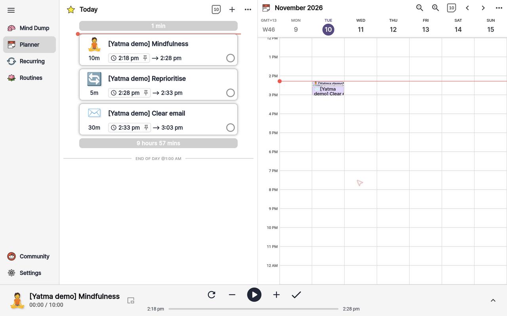
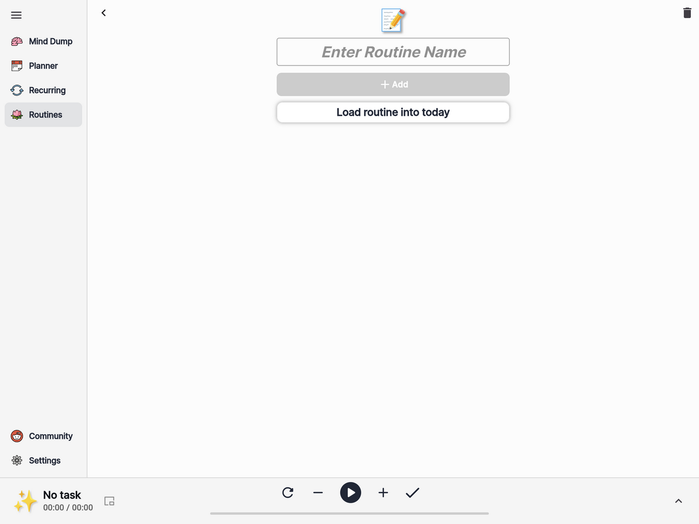
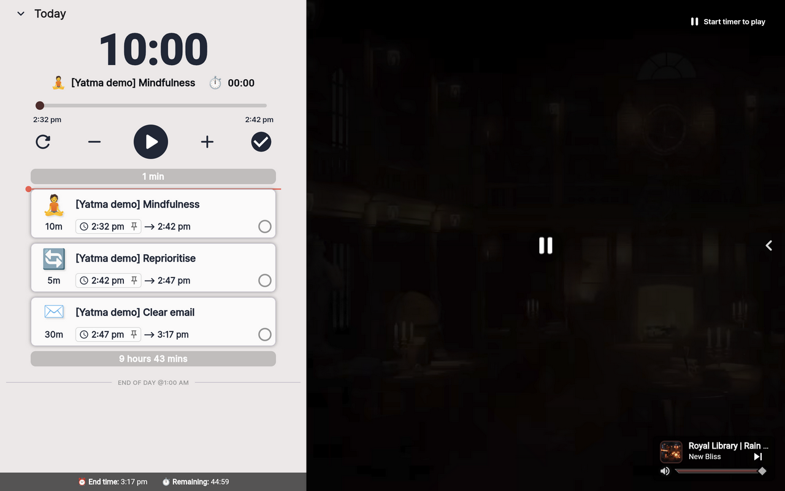
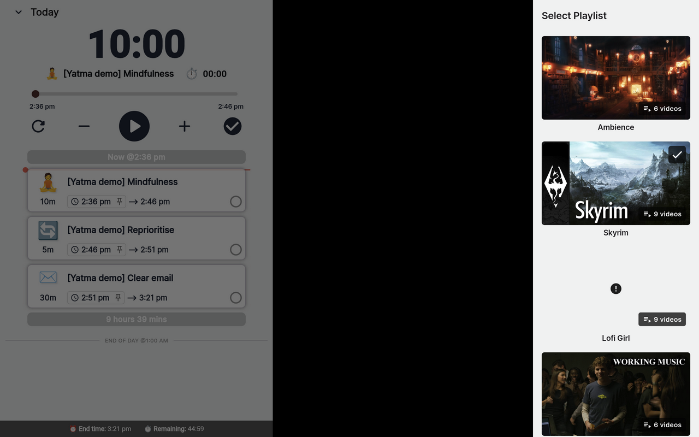
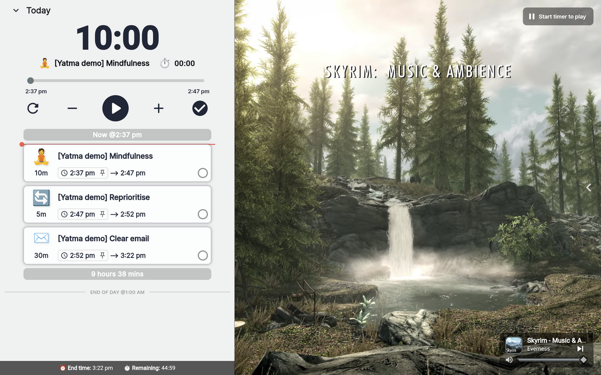

# Chronocat reference captures

Captured 2026-11-10 from [chronocat.app](https://chronocat.app/) through the T3
collaborative browser. The Settings screen reports app version **7.16.11**.
These are original browser captures, without image edits or simulated controls.

The three `[Yatma demo]` blocks were created temporarily for this review using
the user's 10/5/30-minute opening. They are reference fixtures, not existing user
work. No routine was loaded and no new account was created. The media playlist
was changed during the later scene-selection review; timer preferences were not
changed.

## Captures

| Image | Observed screen / useful detail |
| --- | --- |
| [Daily stack](10-daily-stack.png) | Mindfulness 10m, reprioritise 5m, email 30m. Ordered cards left, projected calendar times right, current item/player dock below. |
| [Routine editor](02-routine-editor.png) | Routine name, Add, and an explicit Load routine into today action. This is an empty editor; a populated routine was not saved. |
| [Routines list](03-routines-list.png) | Empty library with Create new routine list. Routines and Recurring are separate views. |
| [Recurring tasks](04-recurring.png) | Separate recurring-work entry point with Create Task and Action shortcuts. |
| [Recurring-block editor](06-recurring-editor.png) | Compact text entry plus duration, day, and optional time controls. No recurring task was submitted. |
| [Inline duration edit](07-duration-picker.png) | Numeric minutes input in the narrower responsive layout. No duration change was submitted here. |
| [Action menu](08-action-menu.png) | Create Task, Add to Start/End, Start/Pause, Next Task, and Insert Routine Above/Below with shortcuts. |
| [Create block](09-create-block.png) | The temporary email block before Save: title/notes above allocation, day, optional pinned time, and Save. |
| [Settings](12-settings.png) | Default duration, 12/24-hour time, chime interval, day boundaries, and the start of an auto-next preference. |
| [Empty planner](01-planner-empty.png) | Initial calendar/list composition and persistent empty player. |
| [Mind Dump](15-mind-dump.png) | Separate unscheduled-work surface alongside the calendar, with the same player dock. |
| [Mind Dump inline entry](16-mind-dump-inline-entry.png) | Inline title/notes, duration, date/time controls, and top-level cancel/finish actions. Captured as a draft; no new backlog item was submitted for this capture. |
| [Recurring, refreshed](17-recurring-view.png) | Current recurring-task view, with separate Routines navigation. The accessible list is empty. |
| [Routines, refreshed](18-routines-view.png) | Current routine-library view and Create new routine list entry point. The accessible library is empty. |
| [Full-screen player](19-fullscreen-player.png) | Opened with the bottom-right up toggle after loading Today. Large timer, current task/elapsed time, reset/minus/Play/plus/finish controls, day stack, projected end/remaining time, and an ambient-media panel. Captured idle at 10:00. |
| [Scene/playlist chooser](20-scene-chooser.png) | Right-hand Select Playlist drawer with Ambience, Skyrim, Lofi Girl, and You are a genius categories. The selected Skyrim category has a checkmark. Some thumbnails failed to load. |
| [Changed scene](21-alternate-scene.png) | The expanded player after selecting Skyrim: the library ambience becomes a waterfall/forest landscape, while the task timer remains idle at 10:00. |
| [Break-entry draft](22-break-entry-draft.png) | Create Block with a five-minute break parsed from the title. Captured before Save and then dismissed; no new break was committed. This demonstrates the general block-entry form, not a verified dedicated break command. |

## Useful patterns for Yatma

- A stable current-item dock makes playing a stack feel different from editing
  a backlog, while the ordered day remains visible above it.
- Durations are prominent; start/end forecasts are secondary. Play is easy to find.
- Templates are deliberately loaded into a day; the Action menu exposes where
  to insert them. Recurrence is a separate concept.
- A compact editor combines title with duration/date/time controls instead of
  requiring a large scheduling form.
- The bottom-right up toggle expands the dock into a dedicated focus view.
  The timer and remaining stack share one column; ambient media occupies the
  other. The day-end forecast remains visible at the foot of the stack.
- Its scene/playlist drawer changes the ambient setting separately from the work
  controls. A library scene and a forest/waterfall scene were both captured.

These are observed presentation patterns, not internal architecture claims.
Yatma keeps the user's rules for durable tasks, tomorrow priority, context
requirements, and configurable break suggestions.

## Verification limits and temporary fixtures

Starting the player twice led this preview to a blank page; reliable running
playback or overtime/deferral interactions were not captured. The gallery shows
an idle current-item player, not verified live playback. Later navigation
presented Create an account and Today remained in a loading state. The user was
asked to re-establish preview login before further checks.

The user subsequently chose to continue with accessible screens instead of
re-establishing login. Two additional Mind Dump captures bring the gallery to
12 images. No further sign-in is required for this reference review; gated
player behavior remains unverified.

Following the user's navigation instructions, refreshed Recurring and Routines
captures and a fully loaded full-screen player bring the gallery to **15 images**.
Opening the expanded view works without starting playback. Its initial task
area showed loading placeholders when opened directly from Routines; loading
Today first then using the up toggle produced the populated timer and day stack.
This verifies the expanded presentation, not running timer/overtime behavior.

The scene-selection review adds the chooser, a changed landscape, and an unsaved
break-entry form, bringing the gallery to **18 images**. The scene switch was
observed with the timer idle; changing scenes during a running interval remains
unverified. No task drag/reorder gesture was exercised in this pass. Existing
Action-menu captures show insertion at the start/end and routines above/below;
Yatma's richer stack-management behavior is specified in its plan rather than
claimed as verified Chronocat behavior.

Cleanup of the three temporary `[Yatma demo]` blocks is **pending** until the day
is accessible again. Do not treat them as the user's own tasks or claim cleanup
has been verified. The empty routine editor was left unnamed, and its subsequent
Routines list still showed no saved routine lists.

## Main reference

## Template reference

## Full-screen player reference

## Scene selection reference

